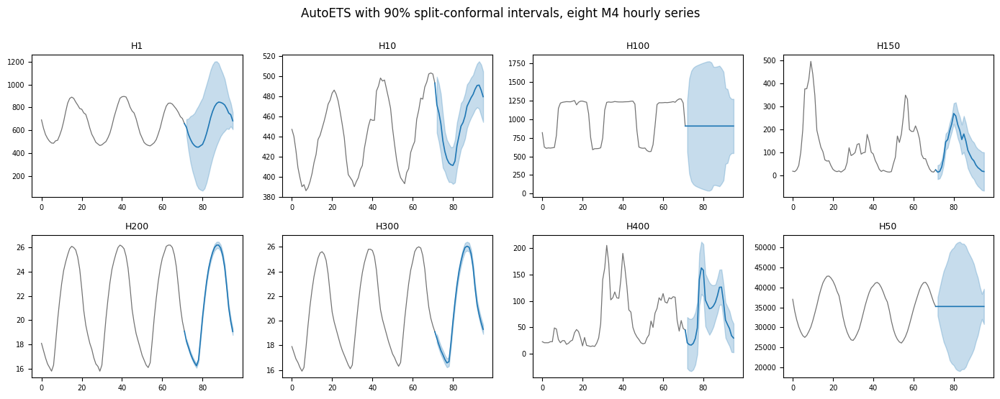

`StatsForecastAdapter` is the most capable adapter in the package: it is
the only one whose support for every capability is unconditional, so all
six methods work behind it whatever model you wrap.
`NeuralForecastAdapter` declares the same set, but its quantile support
depends on the model’s loss.

```python
import matplotlib.pyplot as plt
import numpy as np
import pandas as pd
from statsforecast import StatsForecast
from statsforecast.models import AutoETS, SeasonalNaive

from conformalforecast import (
    ConformalizedQuantileRegression,
    SplitConformal,
    SupportsCrossValidationQuantiles,
    SupportsQuantiles,
    SupportsRefit,
)
from conformalforecast import (
    panel as P,
)
from conformalforecast.adapters import StatsForecastAdapter
from conformalforecast.diagnostics import coverage_by_series, evaluate

HORIZON, SEASON, ALPHA = 24, 24, 0.1
N_HOLDOUT = 4

df = pd.read_csv("nbs/data/m4_hourly_panel.csv", parse_dates=["ds"])
matrix, index = P.long_to_panel(df["y"].to_numpy(), df["unique_id"].to_numpy(), df["ds"].to_numpy())
print("panel", matrix.shape, "over", len(index.series_ids), "series")

# Hold the tail out before anything is fitted, so the coverage measured at the
# end of this page is measured on data no part of the pipeline has seen.
train_df = df[df["ds"] <= df["ds"].max() - pd.Timedelta(hours=N_HOLDOUT * HORIZON)].reset_index(
    drop=True
)
print("training through", train_df["ds"].max(), f"({N_HOLDOUT * HORIZON} hours held out)")
```

``` text
panel (8, 672) over 8 series
training through 2015-01-24 23:00:00 (96 hours held out)
```

## Fit first, wrap second

The adapter does not fit anything. Build and fit your `StatsForecast`
object exactly as you normally would, then hand it over along with the
frame it was trained on as the adapter needs that to reconstruct
histories at the right frequency.

```python
sf = StatsForecast(models=[AutoETS(season_length=SEASON)], freq="h", n_jobs=1)
sf.fit(train_df)

forecaster = StatsForecastAdapter(
    sf=sf,
    train_df=train_df,
    horizon=HORIZON,
    freq="h",
    model_name="AutoETS",  # which of the fitted models this adapter speaks for
)

for capability in (SupportsRefit, SupportsQuantiles, SupportsCrossValidationQuantiles):
    print(f"{capability.__name__:34s} {forecaster.supports(capability)}")
```

``` text
SupportsRefit                      True
SupportsQuantiles                  True
SupportsCrossValidationQuantiles   True
```

`model_name` picks one column out of the fitted output. One adapter
speaks for one model, so wrapping the same `sf` twice conformalizes two
of its models independently.

> **One caveat on sharing a multi-model `StatsForecast`**
>
> Cross-validation runs at the `StatsForecast` level, not per column. If
> the object holds several models and *any* of them lacks a `forward`
> method, `refit=False` fails for all of them — even for an adapter that
> only reads the `AutoETS` column. That is why this page builds a second
> `StatsForecast` below rather than adding `SeasonalNaive` to the one
> above.

## Calibrating

```python
split = SplitConformal(alpha=ALPHA).calibrate_cv(forecaster, n_windows=30)
print("effective windows:", split.n_calibration_samples_)

prediction = split.predict(matrix)
print("point   ", prediction.point.shape)
print("interval", prediction.interval.shape)
```

``` text
effective windows: [30 30 30 30 30 30 30 30]
point    (8, 1, 24)
interval (8, 1, 24, 2)
```

> **`refit` depends on the model, not on you**
>
> `calibrate_cv(refit=False)` — the default — asks statsforecast to
> reuse fitted parameters across cutoffs via each model’s `forward`
> method. `AutoETS` has one, so the call above is fast. `SeasonalNaive`
> does not, and statsforecast raises
> `ValueError: ... The following models do not implement the forward method`
> — pass `refit=True` for those.

```python
sf_naive = StatsForecast(models=[SeasonalNaive(season_length=SEASON)], freq="h", n_jobs=1)
sf_naive.fit(train_df)

naive_forecaster = StatsForecastAdapter(
    sf=sf_naive, train_df=train_df, horizon=HORIZON, freq="h", model_name="SeasonalNaive"
)
naive = SplitConformal(alpha=ALPHA).calibrate_cv(
    naive_forecaster, n_windows=30, refit=True
)  # refit=False would raise
print("SeasonalNaive calibrated with refit=True")
```

``` text
SeasonalNaive calibrated with refit=True
```

## Polars frames

The adapter takes a polars `train_df` just as well, and
conformalforecast installs neither library. Pass the same `freq` you
gave StatsForecast; for polars that is a polars interval, `"1h"`, rather
than the pandas alias `"h"`. Every frame the adapter hands StatsForecast
stays polars, and the calibrated quantile matches the pandas run.

```python
import polars as pl

train_pl = pl.DataFrame({c: train_df[c].to_numpy() for c in train_df.columns})
sf_pl = StatsForecast(models=[SeasonalNaive(season_length=SEASON)], freq="1h", n_jobs=1)
sf_pl.fit(train_pl)

naive_forecaster_pl = StatsForecastAdapter(
    sf=sf_pl, train_df=train_pl, horizon=HORIZON, freq="1h", model_name="SeasonalNaive"
)
naive_pl = SplitConformal(alpha=ALPHA).calibrate_cv(naive_forecaster_pl, n_windows=30, refit=True)
print(type(naive_forecaster_pl.train_df).__module__)
print("same quantile as pandas:", np.allclose(naive_pl.score_quantile_, naive.score_quantile_))
```

``` text
polars.dataframe.frame
same quantile as pandas: True
```

## Per-series intervals

```python
fig, axes = plt.subplots(2, 4, figsize=(14, 5.5))
context = 72

for s, ax in enumerate(axes.ravel()):
    history = matrix[s]
    observed = history[~np.isnan(history)][-context:]
    past = np.arange(len(observed))
    future = np.arange(len(observed), len(observed) + HORIZON)
    join = np.r_[past[-1], future]

    ax.plot(past, observed, color="0.45", lw=0.9)
    ax.plot(join, np.r_[observed[-1], prediction.point[s, 0]], color="C0", lw=1.2)
    ax.fill_between(
        future,
        prediction.interval[s, 0, :, 0],
        prediction.interval[s, 0, :, 1],
        color="C0",
        alpha=0.25,
    )
    ax.set_title(index.series_ids[s], fontsize=9)
    ax.tick_params(labelsize=7)

fig.suptitle("AutoETS with 90% split-conformal intervals, eight M4 hourly series", y=1.0)
fig.tight_layout()
```



Eight series, eight scales — and each band is calibrated on that series’
own residuals. Nothing here is a global multiplier.

## Quantiles, and CQR

`StatsForecastAdapter` exposes statsforecast’s analytical prediction
intervals as quantiles, which is what makes [CQR](../methods/cqr)
available.

```python
cqr = ConformalizedQuantileRegression(alpha=ALPHA)
cqr_fitted = cqr.calibrate_cv(forecaster, n_windows=30)
print("quantile levels requested from statsforecast:", cqr.quantile_levels)
```

``` text
quantile levels requested from statsforecast: [0.05 0.95]
```

> **Two rules statsforecast imposes on quantiles**
>
> -   **Symmetric pairs only.** Quantiles are requested through
>     statsforecast’s *level* API, so 0.05 must be accompanied by 0.95.
>     Asking for an unpaired quantile raises `ValueError` in the
>     adapter. This is shared with the mlforecast and neuralforecast
>     adapters, so asymmetric CQR (`symmetric=False`) is out of reach
>     for all three — see [CQR](../methods/cqr) for the detail.
> -   **No median.** `q == 0.5` is rejected; the level API has no column
>     for it.
>
> `alpha` is translated into a legal pair for you, so you only meet
> these rules if you specify levels by hand.

## Exogenous regressors

An `exog_features` argument tells the adapter which columns of
`train_df` are regressors rather than the target.

> **Declaring `exog_features` removes the quantile capability**
>
> This is the package’s canonical example of a capability that depends
> on *configuration* rather than on class. `StatsForecastAdapter`
> overrides `supports()`: with exogenous regressors declared,
> `predict_quantiles` cannot be served, so `SupportsQuantiles` reports
> `False` and calibrating CQR on that adapter raises
> `UnsupportedCapability` **as soon as it is bound**, before any
> forecasting happens.
>
> Note also that the exogenous `predict` path is a known gap in v0.1 (it
> is `xfail`-marked in the integration suite). See [Exogenous
> features](../capabilities/exogenous) for what does work today.

## Measured coverage across the panel

```python
histories, truths = [], []
for k in range(N_HOLDOUT):
    end = matrix.shape[1] - (N_HOLDOUT - k) * HORIZON
    histories.append(matrix[:, :end])
    truths.append(matrix[:, end : end + HORIZON])
truths = np.stack(truths, axis=1)

reports = {
    name: evaluate(candidate, histories, truths)
    for name, candidate in [
        ("AutoETS + Split", split),
        ("AutoETS + CQR", cqr_fitted),
        ("SeasonalNaive + Split", naive),
    ]
}
for name, report in reports.items():
    print(
        f"{name:24s} coverage {report.marginal_coverage:6.1%}   "
        f"width {report.mean_interval_width:9.1f}   "
        f"Winkler {report.mean_winkler_score:9.1f}"
    )

split_report = reports["AutoETS + Split"]
per_series = coverage_by_series(split_report.intervals, split_report.truths)
print("\nAutoETS + Split, coverage per series:")
for name, value in zip(index.series_ids, per_series, strict=True):
    print(f"  {name:6s} {value:6.1%}")
```

``` text
AutoETS + Split          coverage  87.4%   width    2968.1   Winkler    3264.6
AutoETS + CQR            coverage  80.3%   width    3340.8   Winkler    3604.8
SeasonalNaive + Split    coverage  85.2%   width    1023.6   Winkler    1108.3

AutoETS + Split, coverage per series:
  H1     100.0%
  H10     94.8%
  H100    95.8%
  H150    69.8%
  H200    90.6%
  H300    91.7%
  H400    74.0%
  H50     82.3%
```

Three things worth reading off that table. `SeasonalNaive` produces
intervals nearly three times narrower than `AutoETS` for two points less
coverage, and a Winkler score a third the size. On strongly periodic
hourly data the naive seasonal forecast is simply more accurate, and
conformal prediction inherits that: a better point forecast is the
cheapest way to a narrower interval, and no amount of calibration will
rescue a poor one.

CQR comes out *worse* than split conformal here on all three numbers —
80.3% against 87.4%, wider, higher Winkler. CQR inherits the shape of
the model’s own quantiles, and `AutoETS`’s analytical band on an hourly
series with a 24-hour season is a poor guide to where the errors
actually fall. Conformal calibration can shift that band up or down; it
cannot reshape it. Inheriting a shape is only an advantage when the
shape is right.

And the per-series breakdown spans 69.8% to 100% around an 87.4%
marginal. The two worst are `H150` and `H400`, and the panel-level
number tells you nothing about them — see [ragged
panels](../capabilities/ragged-panels) for why per-series diagnostics
are the ones to watch.

## Next

-   [MLForecast](mlforecast) — the same panel through a gradient-boosted
    model.
-   [NeuralForecast](neuralforecast) — and through a neural one.
-   [Adapters](index) — the capability matrix and how to write your own.
-   [Methods](../methods/index) — all six work behind this adapter.

