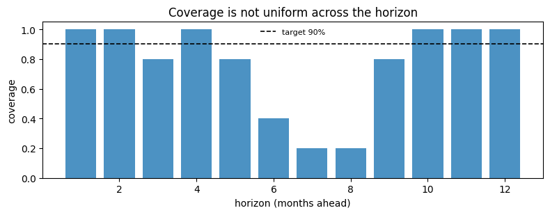
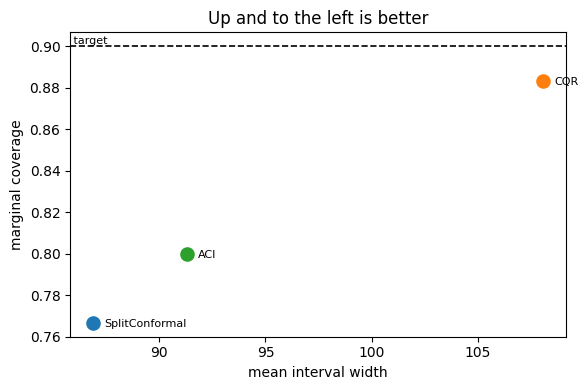
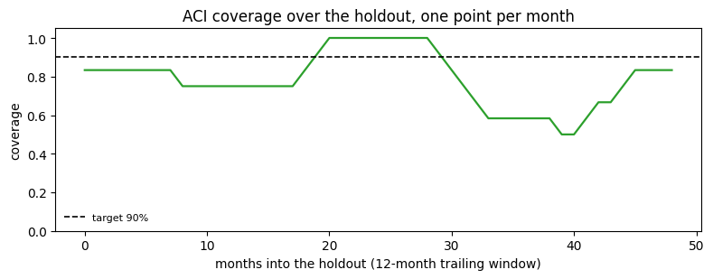

A prediction interval is a claim, and `conformalforecast.diagnostics` is
how you check it. This page covers the two ways to run an evaluation,
the metrics worth looking at, and the one measurement that will lie to
you.

## The two modes

Both take the fitted object a method’s `calibrate` / `calibrate_cv`
returns.

-   **`evaluate(fitted, histories, truths)`** — roll the fitted object
    over held-out windows it has never seen. This is the honest one.
-   **`evaluate_calibration(fitted)`** — replay the method’s own
    calibration data through the state its own calibration implied at
    each window. Cheap, requires no holdout, and **in sample** — so it
    is flattered by construction and does not track the target. Treat it
    as a plumbing check, never as a result.

Both return a `Report`.

```python
import matplotlib.pyplot as plt
import numpy as np
import pandas as pd
from statsforecast import StatsForecast
from statsforecast.models import AutoETS

from conformalforecast import (
    AdaptiveConformalInference,
    ConformalizedQuantileRegression,
    SplitConformal,
)
from conformalforecast.adapters import StatsForecastAdapter
from conformalforecast.diagnostics import (
    coverage_by_horizon,
    coverage_by_series,
    coverage_width_summary,
    evaluate,
    evaluate_calibration,
    mean_interval_width,
    rolling_coverage,
    winkler_score,
)

HORIZON, SEASON, ALPHA = 12, 12, 0.1

df = pd.read_csv("nbs/data/air_passengers.csv", parse_dates=["ds"])
panel = df["y"].to_numpy()[None, :]

N_HOLDOUT = 5
train_end = panel.shape[1] - N_HOLDOUT * HORIZON
train_df = df.iloc[:train_end].reset_index(drop=True)

sf = StatsForecast(models=[AutoETS(season_length=SEASON)], freq="MS", n_jobs=1)
sf.fit(train_df)
forecaster = StatsForecastAdapter(
    sf=sf, train_df=train_df, horizon=HORIZON, freq="MS", model_name="AutoETS"
)

histories, truths = [], []
for k in range(N_HOLDOUT):
    end = panel.shape[1] - (N_HOLDOUT - k) * HORIZON
    histories.append(panel[:, :end])
    truths.append(panel[:, end : end + HORIZON])
truths = np.stack(truths, axis=1)
print("holdout truths", truths.shape, "(n_series, n_windows, horizon)")
```

``` text
holdout truths (1, 5, 12) (n_series, n_windows, horizon)
```

## The optimistic measurement

The two disagree, and the size of the gap is the point. Run both against
the same fitted method: `evaluate_calibration` replays the windows the
method calibrated on, `evaluate` rolls it over a holdout it has never
seen.

```python
split = SplitConformal(alpha=ALPHA).calibrate_cv(forecaster, n_windows=24)

in_sample = evaluate_calibration(split)
out_of_sample = evaluate(split, histories, truths)

print(f"{'in sample (evaluate_calibration)':34s} {in_sample.marginal_coverage:6.1%}")
print(f"{'held out (evaluate)':34s} {out_of_sample.marginal_coverage:6.1%}")
print(f"{'target':34s} {1 - ALPHA:6.1%}")
```

``` text
in sample (evaluate_calibration)    95.8%
held out (evaluate)                 76.7%
target                              90.0%
```

Nineteen points apart, and the flattering number is the one that needs
no holdout. An interval that looks well above target on its own
calibration data is under-covering badly on data it has not seen.

> **`evaluate_calibration` is a smoke test, not a result**
>
> It scores the method on the very windows it calibrated on, so it is
> measuring how well a quantile fits the sample it was taken from. For
> split conformal the answer is “by construction, about right” — which
> tells you the plumbing works and nothing about whether the interval
> will hold next month.
>
> Online methods are flattered further still: the replay is in sample
> with respect to the state that adapted on that same stream. SPCI is
> the extreme case — its interval is conditional on the residual window
> immediately before the step, so its replay re-queries each window’s
> own history rather than broadcasting the final answer. Because its
> quantile regressors were fit on the very residual rows that replay
> then queries, the figure can sit near 100% while a holdout puts the
> same method well below target — so for SPCI in particular, do not read
> the number as coverage. Windows it cannot reach that way, the first
> `window_size` of each series, are excluded rather than counted as
> misses; `Report.n_evaluated_cells` says how many cells the numbers
> came from.
>
> Use it to check that a pipeline runs. Report `evaluate`.

## What a report contains

```python
print(out_of_sample.summary())
```

``` text
Report — SplitConformal
  target coverage: 0.900
  marginal coverage: 0.767
  coverage by horizon: [1.000, 1.000, 0.800, 1.000, 0.800, 0.400, 0.200, 0.200, 0.800, 1.000, 1.000, 1.000]
  mean width: 86.871
  mean Winkler score: 151.761
  n_holdout_samples: 5
```

`summary()` is the human-readable digest. The `Report` object also
carries the raw `intervals`, `truths` and `points` arrays, so any metric
the module exposes can be recomputed from it — which is what the rest of
this page does.

## Coverage, sliced

Marginal coverage is one number over every cell. It is the headline, and
it hides the two things most likely to be wrong.

```python
interval, truth = out_of_sample.intervals, out_of_sample.truths

by_horizon = coverage_by_horizon(interval, truth)
by_series = coverage_by_series(interval, truth)

print("by series ", np.round(by_series, 3))
print("by horizon", np.round(by_horizon, 3))

fig, ax = plt.subplots(figsize=(8, 3.2))
ax.bar(np.arange(1, HORIZON + 1), by_horizon, color="C0", alpha=0.8)
ax.axhline(1 - ALPHA, color="k", lw=1.2, ls="--", label=f"target {1 - ALPHA:.0%}")
ax.set_xlabel("horizon (months ahead)")
ax.set_ylabel("coverage")
ax.set_ylim(0, 1.05)
ax.set_title("Coverage is not uniform across the horizon")
ax.legend(fontsize=8, frameon=False)
fig.tight_layout()
```

``` text
by series  [0.767]
by horizon [1.  1.  0.8 1.  0.8 0.4 0.2 0.2 0.8 1.  1.  1. ]
```



This is what “marginal, not conditional” means in practice. The 76.7%
headline is an average over wildly unequal parts: steps 1 to 5 and 9 to
12 are at or near 100%, while steps 7 and 8 cover 20%. Nothing about the
marginal figure would have told you that the interval essentially fails
at the summer peak.

If your decision depends on a specific lead time, that lead time’s bar
is your coverage — not the headline.

## Width, and why coverage alone is useless

A very large interval can cover everything, so any coverage number has
to be read next to a width.

```python
widths = mean_interval_width(interval)
print("mean width per (series, horizon):", np.round(widths[0], 1))

summary = coverage_width_summary(interval, truth, alpha=ALPHA)
for key, value in summary.items():
    print(f"{key:20s} {value:9.3f}")
```

``` text
mean width per (series, horizon): [ 51.2  54.   63.5  70.   78.1  85.2  89.3 102.8 104.3 109.7 113.6 120.7]
marginal_coverage        0.767
target_coverage          0.900
mean_width              86.871
mean_winkler           151.761
```

The **Winkler score** puts both on one scale: it charges the width of
the interval, plus a penalty of `2/alpha` times how far outside it the
truth landed. Lower is better, and unlike coverage it cannot be gamed by
widening.

```python
scores = winkler_score(interval, truth, alpha=ALPHA)
print("Winkler per cell:", scores.shape, "-> mean", scores.mean().round(1))
```

``` text
Winkler per cell: (1, 5, 12) -> mean 151.8
```

## Comparing methods

The point of a single-number score is that it ranks. Here are three
methods on the same holdout.

```python
cqr = ConformalizedQuantileRegression(alpha=ALPHA).calibrate_cv(forecaster, n_windows=24)
aci = AdaptiveConformalInference(alpha=ALPHA, gamma=0.01).calibrate_cv(forecaster, n_windows=24)

reports = {}
for name, candidate in [("SplitConformal", split), ("CQR", cqr), ("ACI", aci)]:
    reports[name] = evaluate(candidate, histories, truths)

print(f"{'method':16s}{'coverage':>10s}{'width':>10s}{'Winkler':>10s}")
for name, report in reports.items():
    print(
        f"{name:16s}{report.marginal_coverage:9.1%}"
        f"{report.mean_interval_width:10.1f}{report.mean_winkler_score:10.1f}"
    )
```

``` text
method            coverage     width   Winkler
SplitConformal      76.7%      86.9     151.8
CQR                 88.3%     108.1     136.6
ACI                 80.0%      91.3     135.0
```

```python
fig, ax = plt.subplots(figsize=(6, 4))
for i, (name, report) in enumerate(reports.items()):
    ax.scatter(
        report.mean_interval_width,
        report.marginal_coverage,
        s=90,
        color=f"C{i}",
        label=name,
        zorder=3,
    )
    ax.annotate(
        name,
        (report.mean_interval_width, report.marginal_coverage),
        textcoords="offset points",
        xytext=(8, -3),
        fontsize=8,
    )
ax.axhline(1 - ALPHA, color="k", lw=1.2, ls="--")
ax.text(ax.get_xlim()[0], 1 - ALPHA, " target", va="bottom", fontsize=8)
ax.set_xlabel("mean interval width")
ax.set_ylabel("marginal coverage")
ax.set_title("Up and to the left is better")
fig.tight_layout()
```



Read this plot the way you would read a Pareto front: up is valid, left
is useful, and the dashed line is the promise you made.

All three sit below it here, which is the honest outcome — AirPassengers
trends hard, five years of holdout is a genuine distribution shift, and
no method on this page gets a free pass from that. The ranking is still
informative, and nothing dominates: split conformal is the narrowest
(86.9) and covers worst (76.7%), CQR covers best (88.3%) and is the
widest (108.1), and ACI sits between them on both. ACI wins the Winkler
score because a 5% width premium over split conformal bought it a
3-point coverage gain, and Winkler prices that trade for you. That is
the argument for a scalar score: the scatter shows you there is a
trade-off, and the score tells you which side of it to be on.

## Coverage over time

For an online method the question is not “what was the coverage” but
“when was it wrong”. `rolling_coverage` answers that, with one shape
subtlety worth knowing first.

```python
aci_report = reports["ACI"]
print("intervals", aci_report.intervals.shape, " truths", aci_report.truths.shape)
print(
    "rolling_coverage ->", rolling_coverage(aci_report.intervals, aci_report.truths, window=3).shape
)
```

``` text
intervals (1, 5, 12, 2)  truths (1, 5, 12)
rolling_coverage -> (1, 3, 12)
```

It reduces the **samples** axis and leaves the horizon axis alone:
`(n_series, n_samples - window + 1, horizon)`. Five holdout windows with
a window of 3 therefore gives 3 values for *each* of the 12 horizon
steps, not one line.

What we want is calendar time. The five holdout windows are contiguous,
non-overlapping 12-month blocks in chronological order, so their 60
cells *are* the last 60 months of the series. Reshaping to one month per
sample turns the rolling window into a rolling **year**.

```python
# Each holdout window is the 12 months following the previous one, so flattening
# (window, horizon) recovers the last 60 months in order.
months_iv = aci_report.intervals.reshape(1, -1, 1, 2)
months_truth = aci_report.truths.reshape(1, -1, 1)
np.testing.assert_allclose(months_truth[0, :, 0], panel[0, train_end:])

window = 12
rolling = rolling_coverage(months_iv, months_truth, window=window)[0, :, 0]
print(f"{rolling.size} rolling values, from {rolling.min():.0%} to {rolling.max():.0%}")

fig, ax = plt.subplots(figsize=(8, 3.2))
ax.plot(np.arange(rolling.size), rolling, color="C2", lw=1.6)
ax.axhline(1 - ALPHA, color="k", lw=1.2, ls="--", label=f"target {1 - ALPHA:.0%}")
ax.set_xlabel(f"months into the holdout ({window}-month trailing window)")
ax.set_ylabel("coverage")
ax.set_ylim(0, 1.05)
ax.set_title("ACI coverage over the holdout, one point per month")
ax.legend(fontsize=8, frameon=False, loc="lower left")
fig.tight_layout()
```

``` text
49 rolling values, from 50% to 100%
```



Coverage sits in the low 80s for the first year and a half, touches 100%
around months 20 to 28, then falls away to 50% by month 40 before
recovering. The 80% marginal figure is the average of all of that, and
it would never have told you that there is a stretch in the middle of
the holdout where half the observations landed outside a 90% interval.

That is the shape a method losing its calibration makes: fine while the
future resembles the calibration set, worse as the trend pulls away. The
obvious response is to raise ACI’s learning rate so it reacts faster,
and the [ACI page](../methods/aci.html) measures what that buys and what
it costs: pushed far enough, `alpha_t` is driven to zero, the interval
widens without bound, and the coverage is bought by predicting
“somewhere between minus and plus infinity”.
[AgACI](../methods/agaci.html) is the sturdier answer — it runs several
learning rates at once and lets an aggregator discard the ones that blow
up.

> **This view mixes lead times**
>
> Flattening blends the 1-month-ahead cell of each block with its
> 12-month-ahead cell, so a dip may be a bad month or a bad lead time.
> That is the right view for “how did the deployed interval behave over
> the year”, which is what a pipeline re-forecasting annually actually
> experiences, and the wrong view for isolating a horizon step —
> `coverage_by_horizon` is for that. When every prediction shares one
> lead time, as on the [online updating](online-updating.html) page, the
> distinction disappears and `rolling_coverage` needs no reshape.

## Everything else in the module

Not shown above, but available and documented in the diagnostics API
reference:

-   `coverage_per_cell` — the full `(n_series, horizon)` grid behind the
    two reductions used here.
-   `coverage_by_magnitude_bin` — coverage against the size of the
    truth, which finds the “we only miss on big values” failure.
-   `coverage_by_group` — coverage against any grouping you supply, for
    panels with categories.
-   `pinball_loss` — per-quantile loss, for comparing quantile forecasts
    directly.
-   `method_state` and its per-method siblings `aci_state`,
    `agaci_state`, `nexcp_state`, `spci_state` — the internal state of
    an online method, used on the [ACI](../methods/aci.html) and
    [AgACI](../methods/agaci.html) pages.

## Next

-   [Methods overview](../methods/index.html) — choosing what to
    measure.
-   [Online updating](online-updating.html) — keeping a method honest as
    data arrives.
-   [Ragged panels](ragged-panels.html) — per-series diagnostics when
    series differ in length.

