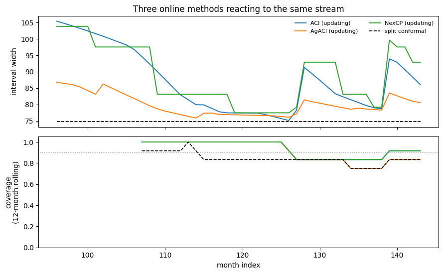

Four of the six methods keep learning after calibration. This page is
the loop they learn in: predict, observe, `update`, repeat — plus what
goes wrong when you skip a step.

## Which methods are online

`IS_ONLINE` is a `ClassVar` — class metadata rather than a config field,
so you can ask before you build anything, and it never shows up in a
constructor or in `model_json_schema()`.

```python
import matplotlib.pyplot as plt
import numpy as np
import pandas as pd
from statsforecast import StatsForecast
from statsforecast.models import AutoETS

from conformalforecast import (
    AdaptiveConformalInference,
    AggregatedAdaptiveConformalInference,
    ConformalizedQuantileRegression,
    NonexchangeableConformalPrediction,
    SequentialPredictiveConformalInference,
    SplitConformal,
)
from conformalforecast.adapters import StatsForecastAdapter
from conformalforecast.diagnostics import method_state

METHODS = [
    SplitConformal,
    ConformalizedQuantileRegression,
    AdaptiveConformalInference,
    AggregatedAdaptiveConformalInference,
    NonexchangeableConformalPrediction,
    SequentialPredictiveConformalInference,
]
for cls in METHODS:
    print(f"{cls.__name__:42s} IS_ONLINE = {cls.IS_ONLINE}")
```

``` text
SplitConformal                             IS_ONLINE = False
ConformalizedQuantileRegression            IS_ONLINE = False
AdaptiveConformalInference                 IS_ONLINE = True
AggregatedAdaptiveConformalInference       IS_ONLINE = True
NonexchangeableConformalPrediction         IS_ONLINE = True
SequentialPredictiveConformalInference     IS_ONLINE = True
```

Offline methods still *have* an `update` method. It lives on the fitted
object that `calibrate` returns, and delegates to an `_update` hook,
which the offline fitted classes leave as the inherited no-op and the
four online ones override. Calling it on an offline method is harmless,
which means a generic pipeline can call `update` unconditionally without
branching on the method type.

## The loop

`calibrate_cv` returns a fitted object, and that object is what learns:
each `update` mutates it in place and returns `None`.

```python
SEASON, ALPHA = 12, 0.1
TRAIN_END = 96  # stream the last 48 months

df = pd.read_csv("nbs/data/air_passengers.csv", parse_dates=["ds"])
panel = df["y"].to_numpy()[None, :]
train_df = df.iloc[:TRAIN_END].reset_index(drop=True)

sf = StatsForecast(models=[AutoETS(season_length=SEASON)], freq="MS", n_jobs=1)
sf.fit(train_df)
forecaster = StatsForecastAdapter(
    sf=sf, train_df=train_df, horizon=1, freq="MS", model_name="AutoETS"
)

method = AdaptiveConformalInference(alpha=ALPHA, gamma=0.02)
fitted = method.calibrate_cv(forecaster, n_windows=48)

for t in range(TRAIN_END, panel.shape[1]):
    prediction = fitted.predict(panel[:, :t])  # 1. predict from what you know
    truth = panel[:, t : t + 1][:, None, :]  # 2. the observation arrives
    fitted.update(prediction.point, truth)  # 3. hand both back

print("state after the stream:")
for key, value in method_state(fitted).items():
    print(f"  {key:22s} {value if np.ndim(value) == 0 else np.round(value, 4)}")
```

``` text
state after the stream:
  alpha_t                [[0.052]]
  alpha_t_minus_alpha    [[-0.048]]
  n_observations         96
  gamma                  0.02
```

> **`truth` must have the forecast’s shape**
>
> `update` takes `(prediction, truth)` with **both** shaped
> `(n_series, 1, horizon)` — the same 3-D `Forecast` shape `predict`
> returns, not the flat `(n_series,)` slice you took out of your panel.
> The `panel[:, t : t + 1][:, None, :]` above is that reshape: one
> series axis, one sample, one horizon step.

> **Snapshots**
>
> Because `update` mutates the fitted object, keep a copy if you need
> the state from before a stream — say, to replay a different stream
> from the same starting point:
> `snapshot = fitted.model_copy(deep=True)`. The copy shares nothing
> with the original, so later updates never reach it.

## What updating buys

Run the same stream several ways: three online methods, one online
method that is calibrated but never fed, and split conformal for
reference.

```python
def stream(cls, *, online=True, **kwargs):
    candidate = cls(alpha=ALPHA, **kwargs).calibrate_cv(forecaster, n_windows=48)
    lower, upper, covered = [], [], []
    for t in range(TRAIN_END, panel.shape[1]):
        prediction = candidate.predict(panel[:, :t])
        lo, hi = prediction.interval[0, 0, 0]
        lower.append(lo)
        upper.append(hi)
        covered.append(lo <= panel[0, t] <= hi)
        if online:
            candidate.update(prediction.point, panel[:, t : t + 1][:, None, :])
    return {"lower": np.array(lower), "upper": np.array(upper), "covered": np.array(covered)}


runs = {
    "ACI (updating)": stream(AdaptiveConformalInference, gamma=0.02),
    "ACI (never updated)": stream(AdaptiveConformalInference, online=False, gamma=0.02),
    "AgACI (updating)": stream(AggregatedAdaptiveConformalInference),
    "NexCP (updating)": stream(NonexchangeableConformalPrediction, rho=0.95),
    "split conformal": stream(SplitConformal, online=False),
}

print(f"{'method':24s}{'coverage':>10s}{'mean width':>13s}")
for name, run in runs.items():
    print(f"{name:24s}{run['covered'].mean():9.1%}{(run['upper'] - run['lower']).mean():13.1f}")
```

``` text
method                    coverage   mean width
ACI (updating)              93.8%         87.2
ACI (never updated)        100.0%        105.4
AgACI (updating)            91.7%         80.0
NexCP (updating)            93.8%         88.9
split conformal             85.4%         74.7
```

The second row is the one to look at, and it is not the failure mode
most people expect. A never-updated ACI does **not** degrade gracefully
into split conformal. It freezes at whatever `alpha_t` the calibration
pass happened to leave behind — 0.016 here, not the 0.1 that was asked
for — and then holds that forever. The result is a 100% covering band,
40% wider than split conformal, aimed at a confidence level nobody
chose.

So an online method that is not fed is worse than an offline one: it is
a fixed interval at an arbitrary level, carrying the overhead of a
controller that never runs. If your pipeline cannot deliver truths back,
pick an offline method deliberately rather than inheriting one by
accident.

```python
months = np.arange(TRAIN_END, panel.shape[1])
fig, (top, bottom) = plt.subplots(2, 1, figsize=(9, 5.6), sharex=True)

for i, name in enumerate(["ACI (updating)", "AgACI (updating)", "NexCP (updating)"]):
    top.plot(months, runs[name]["upper"] - runs[name]["lower"], color=f"C{i}", lw=1.4, label=name)
top.plot(
    months,
    runs["split conformal"]["upper"] - runs["split conformal"]["lower"],
    color="k",
    lw=1.2,
    ls="--",
    label="split conformal",
)
top.set_ylabel("interval width")
top.set_title("Three online methods reacting to the same stream")
top.legend(fontsize=8, frameon=False, ncol=2)

window = 12
for i, name in enumerate(
    ["ACI (updating)", "AgACI (updating)", "NexCP (updating)", "split conformal"]
):
    covered = runs[name]["covered"].astype(float)
    rolled = np.convolve(covered, np.ones(window) / window, mode="valid")
    style = (
        {"color": "k", "lw": 1.2, "ls": "--"}
        if name == "split conformal"
        else {"color": f"C{i}", "lw": 1.4}
    )
    bottom.plot(months[window - 1 :], rolled, label=name, **style)
bottom.axhline(1 - ALPHA, color="0.6", lw=1, ls=":")
bottom.set_ylabel(f"coverage\n({window}-month rolling)")
bottom.set_xlabel("month index")
bottom.set_ylim(0, 1.05)
fig.tight_layout()
```



## Online state survives calibration

`calibrate_cv` does not merely collect residuals for an online method —
it rolls the method’s state forward through every calibration window. By
the time the stream starts, `alpha_t` has already moved.

```python
print(f"before calibration  alpha_t = {ALPHA:.4f} (the configured alpha)")
fresh = AdaptiveConformalInference(alpha=ALPHA, gamma=0.02).calibrate_cv(forecaster, n_windows=48)
print(f"after  calibration  alpha_t = {fresh.alpha_t_[0, 0]:.4f}")
print(f"observations seen   {method_state(fresh)['n_observations']}")
```

``` text
before calibration  alpha_t = 0.1000 (the configured alpha)
after  calibration  alpha_t = 0.0160
observations seen   48
```

This is why `n_observations` after the 48-month stream above reads 96
rather than 48, and why an online method’s diagnostics are cumulative
across both phases.

## Updating out of order

`update` assumes the truth you hand it is the one that followed the
prediction you hand it. Nothing checks that — the arrays have no
timestamps — so an out-of-order or duplicated update corrupts the state
silently.

> **Three rules for a production loop**
>
> 1.  **Update once per observation.** Replaying the same truth twice
>     tells the controller it missed (or hit) twice.
> 2.  **Update in time order.** [NexCP](../methods/nexcp.html) weights
>     by position and [SPCI](../methods/spci.html) regresses on a
>     residual sequence; both read the order as time.
> 3.  **Pair the truth with the prediction that preceded it**, not with
>     the newest forecast. Passing `prediction.point` straight through,
>     as above, makes this automatic.

## Next

-   [ACI](../methods/aci.html) — the controller, in detail.
-   [AgACI](../methods/agaci.html) — several controllers, aggregated.
-   [Diagnostics](./diagnostics.html) — `rolling_coverage` and the
    per-method state helpers, including `method_state` used above.

