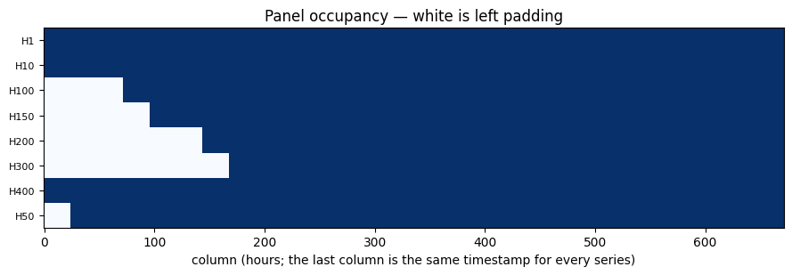
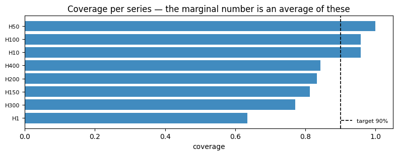

Real panels rarely hold series of equal length: one product launched
last quarter, another has reported for a decade. A panel like that is
**ragged**. This page covers how `conformalforecast` represents it, what
it guarantees, and where it will stop you.

## Left-NaN padding

A `Series` array is always `(n_series, T)`. Short series are padded with
NaN **on the left**, so every series ends on the same column and column
`T-1` means “most recent” for all of them.

That convention is enforced. An interior gap or a trailing NaN is an
error, because either would silently break the “last column is now”
invariant that every method relies on.

```python
import matplotlib.pyplot as plt
import numpy as np
import pandas as pd
from statsforecast import StatsForecast
from statsforecast.models import SeasonalNaive

from conformalforecast import (
    InsufficientCalibrationSamples,
    SplitConformal,
)
from conformalforecast import (
    panel as P,
)
from conformalforecast.adapters import StatsForecastAdapter
from conformalforecast.diagnostics import coverage_by_series, evaluate

HORIZON, SEASON, ALPHA = 24, 24, 0.1
N_HOLDOUT = 4

df = pd.read_csv("nbs/data/m4_hourly_panel.csv", parse_dates=["ds"])
matrix, index = P.long_to_panel(df["y"].to_numpy(), df["unique_id"].to_numpy(), df["ds"].to_numpy())

print("panel      ", matrix.shape)
print("series     ", index.series_ids)
print("lengths    ", index.lengths)
print("NaN cells  ", int(np.isnan(matrix).sum()))

# Hold the tail out before anything is fitted, so the coverage measured at the
# end of this page is measured on data no part of the pipeline has seen.
train_df = df[df["ds"] <= df["ds"].max() - pd.Timedelta(hours=N_HOLDOUT * HORIZON)].reset_index(
    drop=True
)
print("training through", train_df["ds"].max(), f"({N_HOLDOUT * HORIZON} hours held out)")
```

``` text
panel       (8, 672)
series      ('H1', 'H10', 'H100', 'H150', 'H200', 'H300', 'H400', 'H50')
lengths     [672 672 600 576 528 504 672 648]
NaN cells   504
training through 2015-01-24 23:00:00 (96 hours held out)
```

`long_to_panel` returns the matrix and a `PanelIndex` that remembers how
to undo the pivot: the series ids, each series’ length, its offset into
the matrix, and the timestamps. `panel_to_long` uses it to go back,
dropping the padding.

```python
series_ids, timestamps, values = P.panel_to_long(matrix, index)
print(f"{len(values)} non-NaN observations recovered, from {matrix.size} cells")
np.testing.assert_allclose(np.sort(values), np.sort(df["y"].to_numpy()))
print("round trip is lossless")
```

``` text
4872 non-NaN observations recovered, from 5376 cells
round trip is lossless
```

```python
fig, ax = plt.subplots(figsize=(9, 3.2))
observed = ~np.isnan(matrix)
ax.imshow(observed, aspect="auto", cmap="Blues", interpolation="nearest")
ax.set_yticks(np.arange(len(index.series_ids)))
ax.set_yticklabels(index.series_ids, fontsize=8)
ax.set_xlabel("column (hours; the last column is the same timestamp for every series)")
ax.set_title("Panel occupancy — white is left padding")
fig.tight_layout()
```



## Methods propagate NaN, they never impute

A NaN in a calibration array means “this window does not exist for this
series”. A method carries that through scoring and takes
per-`(series, horizon)` quantiles with NaN-aware order statistics, so a
short series is calibrated on its own windows and nobody else’s.

The consequence you can see is `n_calibration_samples_` on the fitted
object: an **effective** count per series, not the number you asked for.

```python
sf = StatsForecast(models=[SeasonalNaive(season_length=SEASON)], freq="h", n_jobs=1)
sf.fit(train_df)
forecaster = StatsForecastAdapter(
    sf=sf, train_df=train_df, horizon=HORIZON, freq="h", model_name="SeasonalNaive"
)

fitted = SplitConformal(alpha=ALPHA).calibrate_cv(forecaster, n_windows=30, refit=True)
print("effective windows per series:", fitted.n_calibration_samples_)
```

``` text
effective windows per series: [30 30 30 30 30 30 30 30]
```

Here every series is long enough that all 30 windows exist, so the
counts are uniform. Ask for more windows than the shortest series can
supply and the arithmetic changes.

## The floor, and the error you get

Every series needs at least `ceil(1 / alpha)` effective windows. Below
that the requested quantile is not attainable from the sample at all,
and `fit` refuses rather than returning something that looks like an
interval.

```python
strict = SplitConformal(alpha=0.01)  # needs 100 windows
try:
    strict.calibrate_cv(forecaster, n_windows=30, refit=True)
except InsufficientCalibrationSamples as error:
    print(type(error).__name__)
    print(error)
    print("offending series indices:", error.series_indices)
    print("names:", [index.series_ids[i] for i in error.series_indices])
```

``` text
InsufficientCalibrationSamples
Series [0, 1, 2, 3, 4, 5, 6, 7] have fewer than ceil(1/alpha) = 100 effective calibration samples for alpha=0.01.
offending series indices: [0, 1, 2, 3, 4, 5, 6, 7]
names: ['H1', 'H10', 'H100', 'H150', 'H200', 'H300', 'H400', 'H50']
```

`series_indices` is the point of the exception: on a 500-series panel
you need to know *which* ones are short, not merely that something was.

> **`ceil(1/alpha)` is arithmetic, not a heuristic**
>
> The conformal quantile is the `k = ceil((1 - alpha)(n + 1))`-th order
> statistic. For that index to exist at all you need `n >= 1/alpha - 1`;
> below it the interval would have to be unbounded. The package rounds
> that up to the `n >= ceil(1/alpha)` the error message quotes, so
> `alpha = 0.01` genuinely requires 100 windows. Lowering `alpha` is not
> free.

## Dense windows vs calendar-aligned cutoffs

`calibrate_cv` has an `aligned` flag, and it decides what axis 1 of the
calibration arrays *means*.

-   **`aligned=False`** (the default) — dense per-series windows. Window
    `k` is “k steps before this series’ own end”. Every series
    contributes the same number of windows, and no NaN is introduced.
-   **`aligned=True`** — calendar-aligned cutoffs. Window `k` is the
    same wall-clock cutoff for every series, and a series that did not
    exist yet gets a NaN cell.

For split conformal the distinction rarely matters: it pools windows and
takes a quantile, and pooling is order-free. For the recency-weighted
methods it matters a great deal — [NexCP](../methods/nexcp) reads axis 1
as chronological age and weights by it, and [SPCI](../methods/spci)
feeds it to a regressor as a sequence. Aligning the axis to the calendar
makes “age” mean the same thing across series.

```python
method = SplitConformal(alpha=ALPHA)
dense = method.calibrate_cv(forecaster, n_windows=30, refit=True, aligned=False)
aligned = method.calibrate_cv(forecaster, n_windows=30, refit=True, aligned=True)

print("dense   ", dense.n_calibration_samples_)
print("aligned ", aligned.n_calibration_samples_)
```

``` text
dense    [30 30 30 30 30 30 30 30]
aligned  [30 30 30 30 30 30 30 30]
```

Identical here, and that is worth understanding rather than glossing
over. This panel was built so every series **ends** on the same
timestamp; they differ only in where they start. The last 30 cutoffs are
therefore the same 30 wall-clock times for all eight series, and every
series is long enough to cover them. The two modes coincide.

They diverge when series end at *different* times, or when a series is
too young to reach the earliest aligned cutoff — then `aligned=True`
produces the NaN cells that the dense mode would have quietly filled
with a different series’ history.

> **Nixtla cross-validation has its own length requirement**
>
> `aligned` is a `conformalforecast` concept, but the windows come from
> the underlying library. statsforecast raises
> `ValueError: The following series are too short for the cross validation settings`
> before either mode is reached if any series cannot supply `n_windows`
> cutoffs. Assemble the arrays yourself — with
> `panel.cv_frames_to_arrays`, in the panel API reference — if you need
> windows the library will not give you.

Which is easy enough to show, since nothing about a retired series is
exotic. Truncate one series’ tail and the two modes stop agreeing.

```python
# Retire one series 48 hours early, so the panel no longer shares an end date.
retired = index.series_ids[0]
last = train_df.loc[train_df["unique_id"] == retired, "ds"].max()
ragged_end_df = train_df[
    (train_df["unique_id"] != retired) | (train_df["ds"] <= last - pd.Timedelta(hours=48))
].reset_index(drop=True)

sf_ragged = StatsForecast(models=[SeasonalNaive(season_length=SEASON)], freq="h", n_jobs=1)
sf_ragged.fit(ragged_end_df)
ragged = StatsForecastAdapter(
    sf=sf_ragged, train_df=ragged_end_df, horizon=HORIZON, freq="h", model_name="SeasonalNaive"
)

dense_preds, _ = ragged.cross_validate(n_windows=10, step_size=1, aligned=False)
aligned_preds, _ = ragged.cross_validate(n_windows=10, step_size=1, aligned=True)

dense_n = method.calibrate_cv(ragged, n_windows=10, aligned=False).n_calibration_samples_
aligned_n = method.calibrate_cv(ragged, n_windows=10, aligned=True).n_calibration_samples_

print(f"{retired} now ends 48h before the other seven\n")
print(f"dense    {dense_preds.shape}   NaN cells {int(np.isnan(dense_preds).sum()):>6}")
print(f"aligned  {aligned_preds.shape}   NaN cells {int(np.isnan(aligned_preds).sum()):>6}")
print("\neffective windows per series")
print("  dense  ", dense_n)
print("  aligned", aligned_n)
```

``` text
H1 now ends 48h before the other seven

dense    (8, 10, 24)   NaN cells      0
aligned  (8, 20, 24)   NaN cells   1920

effective windows per series
  dense   [10 10 10 10 10 10 10 10]
  aligned [10 10 10 10 10 10 10 10]
```

Both modes still give every series its ten windows — dense compacts
them, so `n_calibration_samples_` is 10 either way. The difference is
the axis they sit on.

statsforecast counts cutoffs back from *each series’ own* end date, so
the retired series’ ten cutoffs are 48 hours earlier than everyone
else’s and share nothing with them. Dense mode says “window `k` is k
steps before this series’ end” and returns a compact array. Aligned mode
has to put every distinct cutoff on the calendar axis, so it returns a
wider, mostly-NaN cube: each series occupies only the columns it
actually reached.

> **Aligned mode is not free on a panel with many distinct end dates**
>
> The calendar axis is the union of every series’ cutoffs. When end
> dates are spread out, that union grows with the number of series
> rather than with `n_windows`, and the cube grows with it. Worse, axis
> 1 stops meaning “chronological age”, which is exactly what
> [NexCP](../methods/nexcp) and [SPCI](../methods/spci) read it as.
> Prefer the default `aligned=False` unless you specifically need
> calendar comparability.

## Per-series diagnostics

The real payoff of keeping series separate is that you can ask where the
interval is failing.

```python
histories, truths = [], []
for k in range(N_HOLDOUT):
    end = matrix.shape[1] - (N_HOLDOUT - k) * HORIZON
    histories.append(matrix[:, :end])
    truths.append(matrix[:, end : end + HORIZON])
truths = np.stack(truths, axis=1)

report = evaluate(fitted, histories, truths)
per_series = coverage_by_series(report.intervals, report.truths)

print(f"marginal coverage {report.marginal_coverage:.1%}\n")
print(f"{'series':8s}{'length':>8s}{'coverage':>10s}{'mean width':>12s}")
widths = (report.intervals[..., 1] - report.intervals[..., 0]).mean(axis=(1, 2))
for i, name in enumerate(index.series_ids):
    print(f"{name:8s}{index.lengths[i]:8d}{per_series[i]:9.1%}{widths[i]:12.1f}")
```

``` text
marginal coverage 85.2%

series    length  coverage  mean width
H1           672    63.5%        88.1
H10          672    95.8%        63.8
H100         600    95.8%       705.9
H150         576    81.2%       180.3
H200         528    83.3%         0.3
H300         504    77.1%         0.4
H400         672    84.4%       227.7
H50          648   100.0%      6922.8
```

```python
order = np.argsort(per_series)
fig, ax = plt.subplots(figsize=(8, 3.2))
ax.barh(np.arange(len(order)), per_series[order], color="C0", alpha=0.85)
ax.axvline(1 - ALPHA, color="k", lw=1.2, ls="--", label=f"target {1 - ALPHA:.0%}")
ax.set_yticks(np.arange(len(order)))
ax.set_yticklabels([index.series_ids[i] for i in order], fontsize=8)
ax.set_xlabel("coverage")
ax.set_title("Coverage per series — the marginal number is an average of these")
ax.legend(fontsize=8, frameon=False, loc="lower right")
fig.tight_layout()
```



A panel-level coverage figure is a weighted average of these bars, and
this panel shows why that matters: the 85.2% marginal figure averages
`H1` at 63.5% with `H50` at 100%, and five of the eight series sit below
the 90% target. The headline names none of them — which is why
`coverage_by_series` exists, and why the per-series calibration this
page describes is worth its complexity.

## Next

-   [NexCP](../methods/nexcp) — the method that reads the window axis as
    time.
-   [Diagnostics](diagnostics) — the rest of the per-slice measurements.
-   [Architecture](../concepts/architecture) — the shape conventions in
    full.

