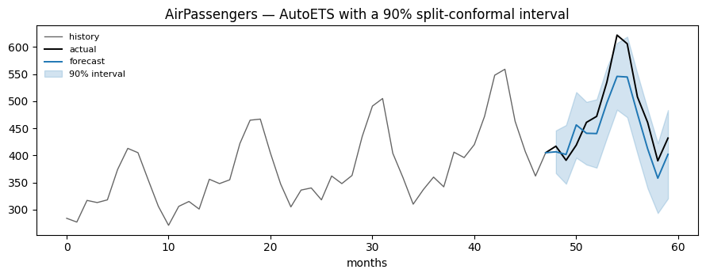

`conformalforecast` turns a point forecaster into one that emits
calibrated prediction intervals. This page goes from a CSV to a 90%
interval with a measured coverage rate, using statsforecast and split
conformal prediction.

Nothing here is specific to statsforecast. The same five steps work for
mlforecast, neuralforecast, or a function you wrote yourself — only the
adapter in step 2 changes.

## 1. The data

AirPassengers: monthly international airline passengers, from 1949 to
1960.

```python
import matplotlib.pyplot as plt
import numpy as np
import pandas as pd

from conformalforecast import SplitConformal
from conformalforecast.adapters import StatsForecastAdapter
from conformalforecast.diagnostics import evaluate

HORIZON, SEASON = 12, 12

df = pd.read_csv("nbs/data/air_passengers.csv", parse_dates=["ds"])
df.head()
```

|     | unique_id     | ds         | y   |
|-----|---------------|------------|-----|
| 0   | AirPassengers | 1949-01-01 | 112 |
| 1   | AirPassengers | 1949-02-01 | 118 |
| 2   | AirPassengers | 1949-03-01 | 132 |
| 3   | AirPassengers | 1949-04-01 | 129 |
| 4   | AirPassengers | 1949-05-01 | 121 |

Hold out the last `HORIZON` months. The forecaster never sees them, so
they are an honest test of the interval at the end.

`panel` is the same data as a `(n_series, T)` array — the shape every
method in the package consumes. AirPassengers is one series, so
`n_series = 1`; the leading axis is always there.

```python
panel = df["y"].to_numpy()[None, :]
cutoff = panel.shape[1] - HORIZON

train_df = df.iloc[:cutoff].reset_index(drop=True)
print(f"panel {panel.shape}, training on the first {cutoff} months")
```

``` text
panel (1, 144), training on the first 132 months
```

## 2. Fit a forecaster and wrap it

Any statsforecast model works. `AutoETS` is used here because it fits in
milliseconds on 132 points and this page is about calibration, not
accuracy — a better model gives *narrower* intervals, not more valid
ones.

The adapter is the uniform interface the conformal method talks to. It
converts Nixtla’s long-format frames into arrays, so the calibration
math never sees a DataFrame.

```python
from statsforecast import StatsForecast
from statsforecast.models import AutoETS

sf = StatsForecast(models=[AutoETS(season_length=SEASON)], freq="MS", n_jobs=1)
sf.fit(train_df)

forecaster = StatsForecastAdapter(
    sf=sf,
    train_df=train_df,
    horizon=HORIZON,
    freq="MS",
    model_name="AutoETS",
)
```

## 3. Calibrate

A method is configuration: `SplitConformal(alpha=0.1)` holds settings
and nothing else. `calibrate_cv` runs the forecaster’s own
cross-validation, calibrates on the resulting errors, and **returns a
new fitted object** — the method itself is left untouched, so the same
configuration can be calibrated again on other data. Every method needs
at least `ceil(1 / alpha)` windows per series (it needs 10 in this case)
and raises `InsufficientCalibrationSamples` naming the offending series
if it does not get them.

> **`refit` and the `forward` method**
>
> `calibrate_cv` defaults to `refit=False`, which asks statsforecast to
> reuse fitted parameters across cutoffs. `AutoETS` implements
> `forward`, so that works and is roughly 15× faster. A model that does
> not, such as `SeasonalNaive`, needs `refit=True`, and statsforecast
> will tell you so.

```python
method = SplitConformal(alpha=0.1)
fitted = method.calibrate_cv(forecaster, n_windows=24)

print("effective windows per series:", fitted.n_calibration_samples_)
print("score quantile by horizon:")
print(np.round(fitted.score_quantile_[0], 1))
```

``` text
effective windows per series: [24]
score quantile by horizon:
[39.4 54.3 60.6 57.8 63.1 65.  61.5 74.3 73.7 73.3 64.6 81.6]
```

`alpha=0.1` asks for 90% intervals. The score quantile is the amount
added to and subtracted from each point forecast, held as one value per
`(series, horizon)` cell.

Notice that it grows with the horizon. That is a fact about the
forecaster rather than about the method: an ETS forecast twelve months
out has more room to drift than one month out, and calibrating per-cell
rather than with a single global constant is what lets the interval say
so.

## 4. Predict

`predict` lives on the fitted object. It takes the history as a
`(n_series, T)` array and returns both the point forecast and the
interval.

```python
prediction = fitted.predict(panel[:, :cutoff])

print("point   ", prediction.point.shape)  # (n_series, 1, horizon)
print("interval", prediction.interval.shape)  # (n_series, 1, horizon, 2)
```

``` text
point    (1, 1, 12)
interval (1, 1, 12, 2)
```

```python
def plot_interval(ax, history, actual, point, interval, *, level=90, context=48):
    """Plot the tail of a history, then a forecast with its interval.

    history  (T,)            past observations
    actual   (horizon,)      the held-out truth, or None
    point    (horizon,)      the point forecast
    interval (horizon, 2)    (lower, upper)
    """
    tail = history[-context:]
    past = np.arange(len(tail))
    future = np.arange(len(tail), len(tail) + len(point))
    # Prepend the last observation so the forecast lines join the history
    # instead of starting one step to its right.
    join = np.r_[past[-1], future]

    ax.plot(past, tail, color="0.4", lw=1, label="history")
    if actual is not None:
        ax.plot(join, np.r_[tail[-1], actual], color="k", lw=1.4, label="actual")
    ax.plot(join, np.r_[tail[-1], point], color="C0", lw=1.4, label="forecast")
    ax.fill_between(
        future,
        interval[:, 0],
        interval[:, 1],
        color="C0",
        alpha=0.2,
        label=f"{level}% interval",
    )
    return ax


fig, ax = plt.subplots(figsize=(9, 3.6))
plot_interval(
    ax,
    panel[0, :cutoff],
    panel[0, cutoff:],
    prediction.point[0, 0],
    prediction.interval[0, 0],
)
ax.set_title("AirPassengers — AutoETS with a 90% split-conformal interval")
ax.set_xlabel("months")
ax.legend(loc="upper left", fontsize=8, frameon=False)
fig.tight_layout()
```



## 5. Check the coverage

An interval is only worth as much as its coverage. `evaluate` rolls the
fitted object over held-out windows and reports what fraction of actuals
landed inside.

One window of 12 steps is too small to measure anything, so roll over
the last four years instead: four windows of 12 months, each predicted
from the history that precedes it.

```python
N_HOLDOUT = 4

histories, truths = [], []
for k in range(N_HOLDOUT):
    end = panel.shape[1] - (N_HOLDOUT - k) * HORIZON
    histories.append(panel[:, :end])
    truths.append(panel[:, end : end + HORIZON])

report = evaluate(fitted, histories, np.stack(truths, axis=1))

print(f"target coverage   {1 - report.alpha:.0%}")
print(f"measured coverage {report.marginal_coverage:.1%}")
print(f"mean width        {report.mean_interval_width:.1f} passengers")
```

``` text
target coverage   90%
measured coverage 93.8%
mean width        128.2 passengers
```

> **Marginal is not conditional**
>
> Conformal coverage is a guarantee *on average* over draws, not a
> promise about any one cell. Coverage averaged over series and horizons
> can sit at 90% while a particular horizon step is systematically
> under-covered — which is exactly what `coverage_by_horizon` and
> `coverage_by_series` are for. AirPassengers also has a strong upward
> trend, so the exchangeability that split conformal assumes is only
> approximately true here; the [adaptive methods](../methods/index)
> exist for precisely that reason.

```python
print(report.summary())
```

``` text
Report — SplitConformal
  target coverage: 0.900
  marginal coverage: 0.938
  coverage by horizon: [1.000, 1.000, 1.000, 1.000, 1.000, 1.000, 0.500, 0.750, 1.000, 1.000, 1.000, 1.000]
  mean width: 128.190
  mean Winkler score: 149.198
  n_holdout_samples: 4
```

The per-horizon breakdown makes the point concretely: the marginal
figure is comfortably above target, but step 7 — the summer peak, where
a trending series is hardest to bound — covered only half its windows. A
single number would have hidden that.

## Next

-   [Methods](../methods/index) — the six methods, what each one is for,
    and when split conformal is not enough.
-   [Diagnostics](../capabilities/diagnostics) — measuring an interval
    properly.
-   [Adapters](../adapters/index) — mlforecast, neuralforecast, or your
    own model.
-   [Architecture](../concepts/architecture) — the method as
    configuration, and the fitted object it returns.

