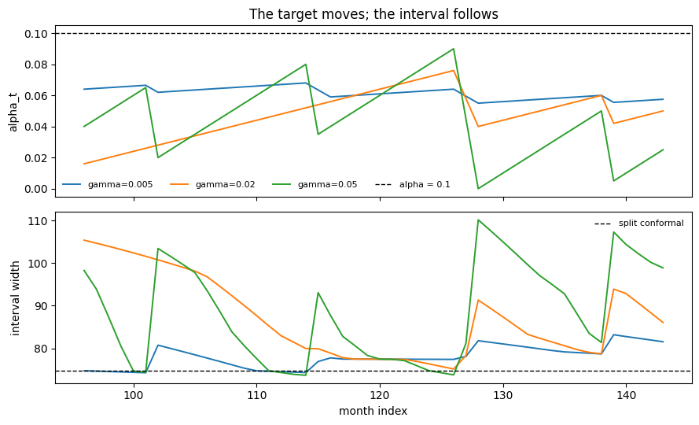

ACI is the simplest of the online methods. Where split conformal fixes
the coverage level once and holds it, ACI adjusts the level it requests
as observations arrive — widening after a miss, tightening after a hit —
which is what lets it keep long-run coverage on a series whose errors
are drifting.

## What it does

ACI keeps a *time-varying* target `alpha_t`, one per `(series, horizon)`
cell, initialised at `alpha`. After each observation it checks whether
the truth fell inside the interval and nudges the target:

``` text
alpha_{t+1} = alpha_t + gamma * (alpha - 1{miss})
```

A miss makes the bracket `(alpha - 1)` negative, so `alpha_t` shrinks
and the next interval is **wider**. A hit adds `gamma * alpha`, so
`alpha_t` creeps up and the interval tightens. The interval itself is
still an ordinary split conformal interval — just taken at `alpha_t`
instead of `alpha`.

This is a control loop, and it has the property a control loop should:
the long-run empirical coverage converges to `1 - alpha` **whatever the
data does**, with no exchangeability assumption at all. What it gives up
is any finite-sample promise about a single step — `alpha_t` can wander
far from `alpha` while it chases a shift.

`gamma` is the learning rate. Gibbs and Candès recommend
`[0.005, 0.05]`; a field validator warns above `0.1`. Small `gamma`
adapts slowly and stays near split conformal; large `gamma` reacts fast
and oscillates.

> **`gamma` too large degenerates, it does not merely wobble**
>
> Nothing stops `alpha_t` from being driven to zero or below by a run of
> misses. At `alpha_t <= 0` the requested quantile sits beyond the
> largest calibration score and the interval becomes infinitely wide —
> technically 100% covering, and useless. On this 48-month stream
> `gamma = 0.2` does exactly that within a few steps. Stay inside the
> recommended range; that is what the constructor warning above `0.1` is
> for.

## Worked example

Adaptation only shows up over many steps, so this page forecasts one
month ahead and streams the last four years through the method one
observation at a time — `predict`, then `update` with what actually
happened. `calibrate_cv` returns a fitted object, and `update` advances
that object’s state in place.

```python
import matplotlib.pyplot as plt
import numpy as np
import pandas as pd
from statsforecast import StatsForecast
from statsforecast.models import AutoETS

from conformalforecast import AdaptiveConformalInference, SplitConformal
from conformalforecast.adapters import StatsForecastAdapter
from conformalforecast.diagnostics import aci_state

SEASON, ALPHA = 12, 0.1
TRAIN_END = 96  # stream the remaining 48 months

df = pd.read_csv("nbs/data/air_passengers.csv", parse_dates=["ds"])
panel = df["y"].to_numpy()[None, :]
train_df = df.iloc[:TRAIN_END].reset_index(drop=True)

sf = StatsForecast(models=[AutoETS(season_length=SEASON)], freq="MS", n_jobs=1)
sf.fit(train_df)
forecaster = StatsForecastAdapter(
    sf=sf, train_df=train_df, horizon=1, freq="MS", model_name="AutoETS"
)


def stream(fitted, *, online=True):
    """Roll one step at a time, recording the interval and whether it covered."""
    lower, upper, covered, alpha_t = [], [], [], []
    for t in range(TRAIN_END, panel.shape[1]):
        prediction = fitted.predict(panel[:, :t])
        truth = panel[:, t : t + 1][:, None, :]  # (n_series, 1, horizon)
        lo, hi = prediction.interval[0, 0, 0]
        lower.append(lo)
        upper.append(hi)
        covered.append(lo <= panel[0, t] <= hi)
        if online:
            alpha_t.append(float(fitted.alpha_t_[0, 0]))
            fitted.update(prediction.point, truth)
    return {
        "lower": np.array(lower),
        "upper": np.array(upper),
        "covered": np.array(covered),
        "alpha_t": np.array(alpha_t),
    }
```

Three learning rates, plus split conformal as the `gamma = 0` reference.
Each one is calibrated on the same 48 cross-validation windows before
the stream starts.

```python
GAMMAS = [0.005, 0.02, 0.05]

runs = {}
for gamma in GAMMAS:
    method = AdaptiveConformalInference(alpha=ALPHA, gamma=gamma)
    fitted = method.calibrate_cv(forecaster, n_windows=48)
    runs[f"ACI gamma={gamma}"] = stream(fitted)
    if gamma == 0.05:
        tuned = fitted

split = SplitConformal(alpha=ALPHA).calibrate_cv(forecaster, n_windows=48)
runs["split conformal"] = stream(split, online=False)

for name, run in runs.items():
    width = (run["upper"] - run["lower"]).mean()
    print(f"{name:20s} coverage {run['covered'].mean():6.1%}   mean width {width:6.1f}")
```

``` text
ACI gamma=0.005      coverage  87.5%   mean width   78.0
ACI gamma=0.02       coverage  93.8%   mean width   87.2
ACI gamma=0.05       coverage  89.6%   mean width   88.4
split conformal      coverage  85.4%   mean width   74.7
```

## What `alpha_t` did

```python
months = np.arange(TRAIN_END, panel.shape[1])

fig, (top, bottom) = plt.subplots(2, 1, figsize=(9, 5.5), sharex=True)

for i, gamma in enumerate(GAMMAS):
    run = runs[f"ACI gamma={gamma}"]
    top.plot(months, run["alpha_t"], color=f"C{i}", lw=1.4, label=f"gamma={gamma}")
    bottom.plot(months, run["upper"] - run["lower"], color=f"C{i}", lw=1.4)

top.axhline(ALPHA, color="k", lw=1, ls="--", label="alpha = 0.1")
top.set_ylabel("alpha_t")
top.set_title("The target moves; the interval follows")
top.legend(fontsize=8, frameon=False, ncol=4)

split_width = (runs["split conformal"]["upper"] - runs["split conformal"]["lower"]).mean()
bottom.axhline(split_width, color="k", lw=1, ls="--", label="split conformal")
bottom.set_ylabel("interval width")
bottom.set_xlabel("month index")
bottom.legend(fontsize=8, frameon=False)
fig.tight_layout()
```



None of the three starts at `alpha = 0.1`, because `calibrate_cv`
already rolled `alpha_t` forward through its 48 windows — an online
method adapts during calibration too, not only during the stream.

Read the top panel as the controller’s state. Every miss knocks
`alpha_t` down by `gamma * (1 - alpha)` — a visible cliff — and every
hit lets it drift back up by `gamma * alpha`, a tenth as fast. That
asymmetry is the algorithm: it is expensive to miss and cheap to be a
little conservative.

`gamma = 0.005` barely leaves the split-conformal line over 48 months;
`gamma = 0.05` reacts within a step or two. The bottom panel is the
consequence: split conformal holds one width for four years, while the
adaptive runs breathe.

Which rate is right depends on how fast your process actually moves, and
you do not know that in advance. [AgACI](agaci.html) exists so you do
not have to guess.

```python
state = aci_state(tuned)
print(f"gamma                {state['gamma']}")
print(f"observations seen    {state['n_observations']}")
print(f"final alpha_t        {state['alpha_t'][0, 0]:.4f}")
print(f"drift from alpha     {state['alpha_t_minus_alpha'][0, 0]:+.4f}")
```

``` text
gamma                0.05
observations seen    96
final alpha_t        0.0300
drift from alpha     -0.0700
```

`n_observations` counts the calibration windows *and* the streamed
updates — online state does not reset when you stop calibrating and
start predicting.

## When not to use it

-   **You cannot feed truths back.** ACI without `update` is split
    conformal with extra steps. If your pipeline never learns what
    actually happened, use [split conformal](split.html) or
    [CQR](cqr.html) and be honest about it.
-   **You do not want to tune `gamma`.** Use [AgACI](agaci.html), which
    runs a panel of learning rates and aggregates them online.
-   **Your problem is width, not level.** ACI moves the coverage target;
    it does not change the *shape* of the band. If the complaint is “too
    wide in calm periods, too narrow in volatile ones”, that is
    [SPCI](spci.html).

## References

I. Gibbs and E. Candès, “Adaptive Conformal Inference Under Distribution
Shift,” arXiv.org, 2021. https://arxiv.org/abs/2106.00170.

## Next

-   [AgACI](agaci.html) — ACI without choosing `gamma`.
-   [NexCP](nexcp.html) — the other answer to drift: down-weight stale
    residuals.
-   [Online updating](../capabilities/online-updating.html) — the
    `predict`/`update` loop in general.

