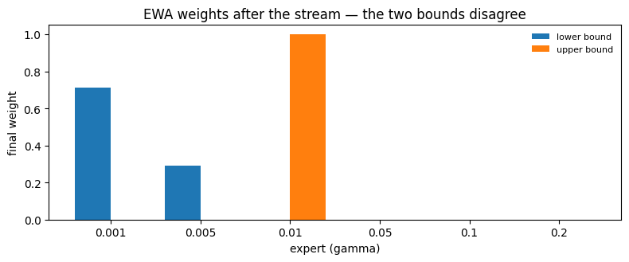
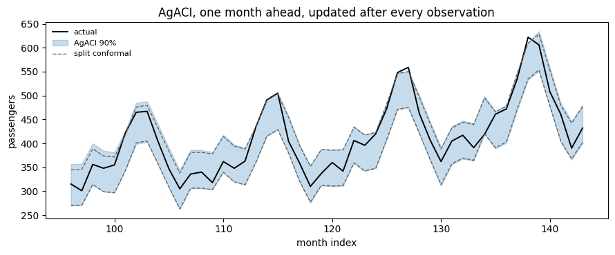

AgACI removes the one decision [ACI](aci) forces on you. Instead of
picking a learning rate, run several and let online aggregation decide,
continuously, how much to trust each.

## What it does

AgACI maintains `K` independent ACI experts, one per candidate `gamma`.
At each step every expert proposes an interval, and the two bounds are
aggregated separately:

``` text
lower_t = sum_k w_k^lo * lower_t^k
upper_t = sum_k w_k^up * upper_t^k
```

The weights come from an online aggregator — exponentially weighted
averaging by default — fed the **pinball loss** of each expert at its
own bound: `alpha/2` for the lower, `1 - alpha/2` for the upper. An
expert whose lower bound has been well placed gains weight on the lower
bound only.

That is why the two bounds get separate weight vectors, and why an AgACI
interval is generally **asymmetric** even when every underlying expert
is symmetric. The best learning rate for tracking the bottom of a
distribution is not usually the best one for the top.

> **Original aggregation**
>
> The original aggregation is the Bernstein online aggregation but this
> implementation defaults to exponentially weighted averaging, and the
> `aggregator` parameter lets you supply your own, as a prototype
> instance.

## Worked example

Same setup as the ACI page — one month ahead, streaming the last four
years — so the numbers are directly comparable.

```python
import warnings

import matplotlib.pyplot as plt
import numpy as np
import pandas as pd
from statsforecast import StatsForecast
from statsforecast.models import AutoETS

from conformalforecast import (
    AdaptiveConformalInference,
    AggregatedAdaptiveConformalInference,
    SplitConformal,
)
from conformalforecast.adapters import StatsForecastAdapter
from conformalforecast.diagnostics import agaci_state

SEASON, ALPHA = 12, 0.1
TRAIN_END = 96

# The gamma=0.2 expert below is deliberately outside the recommended range
# and warns on construction. That is the point of the table, not a surprise.
warnings.filterwarnings("ignore", message="gamma=.* is unusually large")

df = pd.read_csv("nbs/data/air_passengers.csv", parse_dates=["ds"])
panel = df["y"].to_numpy()[None, :]
train_df = df.iloc[:TRAIN_END].reset_index(drop=True)

sf = StatsForecast(models=[AutoETS(season_length=SEASON)], freq="MS", n_jobs=1)
sf.fit(train_df)
forecaster = StatsForecastAdapter(
    sf=sf, train_df=train_df, horizon=1, freq="MS", model_name="AutoETS"
)


def stream(fitted, *, online=True):
    lower, upper, covered = [], [], []
    for t in range(TRAIN_END, panel.shape[1]):
        prediction = fitted.predict(panel[:, :t])
        lo, hi = prediction.interval[0, 0, 0]
        lower.append(lo)
        upper.append(hi)
        covered.append(lo <= panel[0, t] <= hi)
        if online:
            fitted.update(prediction.point, panel[:, t : t + 1][:, None, :])
    return {"lower": np.array(lower), "upper": np.array(upper), "covered": np.array(covered)}
```


```python
GAMMAS = (0.001, 0.005, 0.01, 0.05, 0.1, 0.2)

agaci = AggregatedAdaptiveConformalInference(alpha=ALPHA, gammas=GAMMAS).calibrate_cv(
    forecaster, n_windows=48
)
runs = {"AgACI": stream(agaci)}

# Every expert on its own, for comparison.
for gamma in GAMMAS:
    single = AdaptiveConformalInference(alpha=ALPHA, gamma=gamma).calibrate_cv(
        forecaster, n_windows=48
    )
    runs[f"ACI gamma={gamma}"] = stream(single)

split = SplitConformal(alpha=ALPHA).calibrate_cv(forecaster, n_windows=48)
runs["split conformal"] = stream(split, online=False)

scale = panel.max()  # anything far above the data's own range is not an interval

for name, run in runs.items():
    width = (run["upper"] - run["lower"]).mean()
    shown = f"{width:8.1f}" if width < 100 * scale else f"{width:8.1e}  <- degenerate"
    print(f"{name:20s} coverage {run['covered'].mean():6.1%}   mean width {shown}")
```

``` text
AgACI                coverage  91.7%   mean width     80.0
ACI gamma=0.001      coverage  83.3%   mean width     74.9
ACI gamma=0.005      coverage  87.5%   mean width     78.0
ACI gamma=0.01       coverage  93.8%   mean width     83.3
ACI gamma=0.05       coverage  89.6%   mean width     88.4
ACI gamma=0.1        coverage  91.7%   mean width 2.5e+299  <- degenerate
ACI gamma=0.2        coverage  89.6%   mean width 4.6e+299  <- degenerate
split conformal      coverage  85.4%   mean width     74.7
```

> **Note what happened to the largest experts**
>
> `gamma = 0.2` on its own degenerates — a run of misses drives its
> `alpha_t` to zero and its interval becomes infinitely wide. AgACI
> contains that expert and is unharmed, because the aggregator simply
> stops giving it weight. That is the practical argument for aggregation
> over tuning: a bad `gamma` chosen by hand is a production incident,
> while a bad `gamma` inside AgACI is a line on a weight plot.
>
> The clipping arguments `interval_clip_lower` and `interval_clip_upper`
> are the second line of defence; left at `None` they are derived at fit
> time from the calibration truths.

## Where the weight went

```python
state = agaci_state(agaci)
weights_lo = state["weights_lower"][:, 0, 0]
weights_up = state["weights_upper"][:, 0, 0]

x = np.arange(len(GAMMAS))
fig, ax = plt.subplots(figsize=(8, 3.4))
ax.bar(x - 0.2, weights_lo, width=0.4, label="lower bound", color="C0")
ax.bar(x + 0.2, weights_up, width=0.4, label="upper bound", color="C1")
ax.set_xticks(x)
ax.set_xticklabels([str(g) for g in GAMMAS])
ax.set_xlabel("expert (gamma)")
ax.set_ylabel("final weight")
ax.set_title("EWA weights after the stream — the two bounds disagree")
ax.legend(fontsize=8, frameon=False)
fig.tight_layout()

print("best expert, lower bound:", GAMMAS[state["best_expert_per_cell_lower"][0, 0]])
print("best expert, upper bound:", GAMMAS[state["best_expert_per_cell_upper"][0, 0]])
```

``` text
best expert, lower bound: 0.001
best expert, upper bound: 0.01
```



## The resulting band

```python
months = np.arange(TRAIN_END, panel.shape[1])
truth = panel[0, TRAIN_END:]
agaci_run = runs["AgACI"]

fig, ax = plt.subplots(figsize=(9, 3.8))
ax.plot(months, truth, color="k", lw=1.4, label="actual")
ax.fill_between(
    months,
    agaci_run["lower"],
    agaci_run["upper"],
    color="C0",
    alpha=0.25,
    label="AgACI 90%",
)
ax.plot(
    months, runs["split conformal"]["lower"], color="0.4", lw=1, ls="--", label="split conformal"
)
ax.plot(months, runs["split conformal"]["upper"], color="0.4", lw=1, ls="--")
ax.set_xlabel("month index")
ax.set_ylabel("passengers")
ax.set_title("AgACI, one month ahead, updated after every observation")
ax.legend(fontsize=8, frameon=False, loc="upper left")
fig.tight_layout()
```



The AgACI band is not centred on the forecast: the two bounds are
aggregated with different weights, so they move independently. On a
trending series that is a feature — the upper bound has more work to do
than the lower one.

## When not to use it

-   **You have very few update steps.** Aggregation needs time to sort
    the experts out. Over a handful of observations AgACI is `K` ACIs
    paying rent, and plain [ACI](aci) with a sensible `gamma` is
    simpler.
-   **You need a symmetric interval by contract.** AgACI’s asymmetry is
    intrinsic.
-   **Cost matters and `K` is large.** AgACI runs every expert every
    step. The expert axis is batched, so this is array work rather than
    a Python loop, but it is still `K` times the state.

## References

M. Zaffran, A. Dieuleveut, F. Olivier, Y. Goude, and J. Josse, “Adaptive
Conformal Predictions for Time Series,” arXiv.org, 2022.
https://arxiv.org/abs/2202.07282.

## Next

-   [NexCP](nexcp) — drift handled by weighting residuals instead of
    targets.
-   [SPCI](spci) — width that varies per step.
-   [Online updating](../capabilities/online-updating) — the general
    loop.

