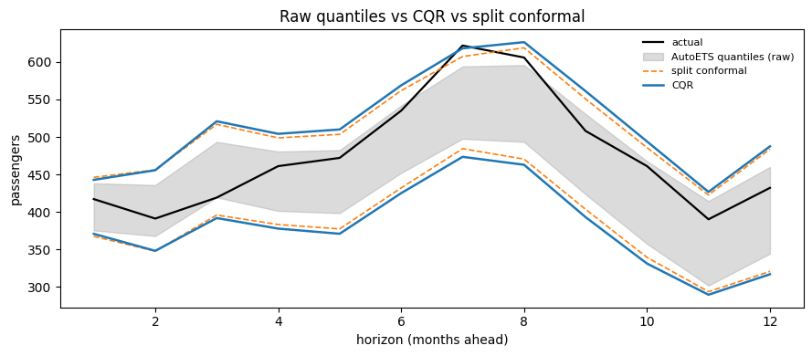

CQR conformalizes a forecaster that already emits quantiles. Instead of
building a band out of absolute residuals, it takes the model’s own
quantile forecast and corrects it just enough to hit the coverage
target.

## What it does

The forecaster supplies a lower and upper quantile, `q_lo` and `q_hi`,
at levels `alpha/2` and `1 - alpha/2`. The nonconformity score asks how
far outside that band the truth fell:

``` text
E = max(q_lo - y, y - q_hi)
```

`E` is negative when the truth landed comfortably inside, positive when
it fell outside. Take the exact conformal quantile `Q` of the
calibration `E`s and widen — or, if the model was over-cautious,
**narrow** — the band:

``` text
[q_lo - Q, q_hi + Q]
```

That negative case is the whole point. Split conformal can only add
width. CQR inherits the *shape* of the model’s quantile forecast — wide
at a volatile season, narrow at a calm one — and conformal calibration
only fixes its overall level.

## Worked example

`AutoETS` produces analytical prediction intervals, which
`StatsForecastAdapter` exposes as quantiles. That makes it
quantile-capable, so it can back CQR.

> **Not every adapter can**
>
> `ConformalizedQuantileRegression` declares `SupportsQuantiles` in its
> `REQUIRED_CAPABILITIES`, and the check runs where the forecaster is
> bound — the first thing both `calibrate` and `calibrate_cv` do.
> `MLForecastAdapter` does not implement quantiles, so calibrating CQR
> on one raises `UnsupportedCapability` before any forecasting happens,
> rather than failing later inside `predict`. `NeuralForecastAdapter`
> supports it only when the model’s loss is a quantile loss such as
> `MQLoss` — it overrides `supports()` to inspect the loss, so the same
> class passes or fails depending on how it was trained.

```python
import matplotlib.pyplot as plt
import numpy as np
import pandas as pd
from statsforecast import StatsForecast
from statsforecast.models import AutoETS

from conformalforecast import ConformalizedQuantileRegression, SplitConformal
from conformalforecast.adapters import StatsForecastAdapter
from conformalforecast.diagnostics import evaluate

HORIZON, SEASON, ALPHA = 12, 12, 0.1

df = pd.read_csv("nbs/data/air_passengers.csv", parse_dates=["ds"])
panel = df["y"].to_numpy()[None, :]
cutoff = panel.shape[1] - HORIZON
train_df = df.iloc[:cutoff].reset_index(drop=True)

sf = StatsForecast(models=[AutoETS(season_length=SEASON)], freq="MS", n_jobs=1)
sf.fit(train_df)
forecaster = StatsForecastAdapter(
    sf=sf, train_df=train_df, horizon=HORIZON, freq="MS", model_name="AutoETS"
)

cqr = ConformalizedQuantileRegression(alpha=ALPHA)
cqr_fitted = cqr.calibrate_cv(forecaster, n_windows=24)
print("quantile levels:", cqr.quantile_levels)
```

``` text
quantile levels: [0.05 0.95]
```

`calibrate_cv` noticed that the method `CONSUMES_QUANTILES` and asked
the adapter for a *quantile* cross-validation rather than a point one.
You never request that yourself.

> **statsforecast quantile rules**
>
> Quantiles must arrive in symmetric pairs, and `q == 0.5` is rejected —
> the level API statsforecast exposes has no median column. `alpha=0.1`
> becomes the pair `(0.05, 0.95)` automatically, which is what
> `quantile_levels` shows above. You only choose levels yourself when
> you pass `symmetric=False` with explicit `alpha_lo` and `alpha_hi`.

## What conformalizing changed

Compare three bands on the same axis: the raw `AutoETS` quantiles, the
same quantiles after CQR, and a split-conformal band for reference.

```python
prediction = cqr_fitted.predict(panel[:, :cutoff])

# The model's own quantiles, before any conformal correction.
raw = forecaster.predict_quantiles(panel[:, :cutoff], cqr.quantile_levels)
raw_lo, raw_hi = raw[0, 0], raw[0, 1]

split = SplitConformal(alpha=ALPHA)
split_fitted = split.calibrate_cv(forecaster, n_windows=24)
split_interval = split_fitted.predict(panel[:, :cutoff]).interval[0, 0]

steps = np.arange(1, HORIZON + 1)
fig, ax = plt.subplots(figsize=(9, 4))
ax.plot(steps, panel[0, cutoff:], color="k", lw=1.6, label="actual")
ax.fill_between(steps, raw_lo, raw_hi, color="0.6", alpha=0.35, label="AutoETS quantiles (raw)")
ax.plot(steps, split_interval[:, 0], color="C1", lw=1.2, ls="--", label="split conformal")
ax.plot(steps, split_interval[:, 1], color="C1", lw=1.2, ls="--")
ax.plot(steps, prediction.interval[0, 0, :, 0], color="C0", lw=1.8, label="CQR")
ax.plot(steps, prediction.interval[0, 0, :, 1], color="C0", lw=1.8)
ax.set_xlabel("horizon (months ahead)")
ax.set_ylabel("passengers")
ax.set_title("Raw quantiles vs CQR vs split conformal")
ax.legend(fontsize=8, frameon=False)
fig.tight_layout()
```



```python
widths = {
    "AutoETS quantiles (raw)": raw_hi - raw_lo,
    "CQR": prediction.interval[0, 0, :, 1] - prediction.interval[0, 0, :, 0],
    "split conformal": split_interval[:, 1] - split_interval[:, 0],
}
for name, w in widths.items():
    print(f"{name:26s} mean width {w.mean():7.1f}   at h=1 {w[0]:6.1f}   at h=12 {w[-1]:6.1f}")
```

``` text
AutoETS quantiles (raw)    mean width    92.0   at h=1   63.0   at h=12  115.7
CQR                        mean width   138.9   at h=1   72.1   at h=12  170.7
split conformal            mean width   128.2   at h=1   78.8   at h=12  163.2
```

The raw quantiles and the CQR band have the same *shape* — CQR pushed
each edge out by one constant per horizon step, which is exactly what
the score above does. It kept the seasonal bulge around step 7 that the
raw quantiles already had.

Here it widened: `AutoETS`’s analytical 90% band averaged 92 passengers
wide and was too confident, so the conformal quantile came out positive.
Had the model been over-cautious the score would have been negative and
CQR would have pulled the band *in* — the move split conformal cannot
make, because an absolute residual is never negative.

## Measured coverage

```python
N_HOLDOUT = 4
histories, truths = [], []
for k in range(N_HOLDOUT):
    end = panel.shape[1] - (N_HOLDOUT - k) * HORIZON
    histories.append(panel[:, :end])
    truths.append(panel[:, end : end + HORIZON])
truths = np.stack(truths, axis=1)

for name, fitted in [("CQR", cqr_fitted), ("SplitConformal", split_fitted)]:
    report = evaluate(fitted, histories, truths)
    print(
        f"{name:16s} coverage {report.marginal_coverage:6.1%}   "
        f"width {report.mean_interval_width:7.1f}   "
        f"Winkler {report.mean_winkler_score:7.1f}"
    )
```

``` text
CQR              coverage  93.8%   width   126.6   Winkler   141.9
SplitConformal   coverage  93.8%   width   128.2   Winkler   149.2
```

Both hit the same coverage, and here CQR does it slightly narrower — so
its Winkler score, which charges for width and for misses on one scale,
comes out lower.

That reverses the single-window comparison above, where CQR came out
*wider* (138.9 against 128.2). Split conformal’s width is fixed by its
score quantile, so it is the same 128.2 in every window; CQR’s rides on
the model’s own quantiles and moves window by window. Averaged over the
four holdout windows it lands narrower, even though it was wider in the
last one.

That is the shape advantage paying off: on a series whose uncertainty is
not constant across the horizon, inheriting the model’s profile beats a
flat band.

## Asymmetric intervals

By default CQR requests the `alpha/2` and `1 - alpha/2` quantiles from
the forecaster. When the cost of being too low differs from the cost of
being too high — inventory, staffing, capacity planning — request an
off-centre pair with `symmetric=False`. The levels move the band’s width
and position, not its validity: one conformal quantile of the CQR score
is added to both sides, so the guarantee is joint coverage `1 - alpha`
whatever the levels are, with no per-tail guarantee. By convention the
pair still satisfies `alpha_lo + (1 - alpha_hi) = alpha`:

```python
cqr = ConformalizedQuantileRegression(
    alpha=0.1, symmetric=False, alpha_lo=0.02, alpha_hi=0.92
)
fitted = cqr.calibrate_cv(forecaster, n_windows=24)
```

> **No shipped Nixtla adapter can serve asymmetric levels in v0.1**
>
> That snippet is not executed on this page, because it would fail with
> any of the three Nixtla adapters — statsforecast, mlforecast **and**
> neuralforecast alike.
>
> The constraint is not in CQR. The method accepts any
> `0 < alpha_lo < 0.5 < alpha_hi < 1` with
> `alpha_lo + (1 - alpha_hi) = alpha`, and its array surface never
> learns which levels produced its inputs. It is in the bridge to the
> Nixtla libraries: all three expose intervals through an integer
> `level` API, where `level=90` means the 5th *and* 95th percentiles
> inseparably. The shared helper
> `adapters/_nixtla_common.quantiles_to_levels` therefore rejects any
> quantile whose mirror is absent:
>
> ``` text
> ValueError: Quantile 0.02 requires its symmetric pair 0.98 to also be
> present in quantiles. Got [0.02, 0.92].
> ```
>
> Training a neuralforecast model with `MQLoss(quantiles=[0.02, 0.92])`
> does not help — the adapter still requests those quantiles through
> `level=`, and raises the same error before the model is consulted.
>
> What does work is an adapter that implements `SupportsQuantiles`
> directly and serves arbitrary levels, bypassing the level API. That is
> a dozen lines on top of your own model; `tests/helpers.py` has a
> working example, and [Adapters](../adapters/index.html) covers the
> contract. Until a Nixtla adapter grows a non-level quantile path, that
> is the only route to an asymmetric interval *from CQR*.
>
> It is not the only route to an asymmetric conformal interval.
> [`SplitConformal(symmetric=False, alpha_lo=..., alpha_hi=...)`](./split.html)
> takes one one-sided conformal quantile of the **signed** residual per
> tail, so it needs no quantile capability at all and works through
> every adapter, the three Nixtla ones included. What it buys is
> different, though: its two offsets are constants added to the point
> forecast, so it corrects a forecaster that is *consistently* biased,
> while CQR’s quantiles track skew that varies with each input. Reach
> for it when one tail carries the real cost and a fixed shift is
> enough; reach for CQR when the asymmetry itself depends on the
> features.

## When not to use it

-   **Your forecaster has no quantiles.** Most gradient-boosting setups
    through mlforecast do not, and CQR will refuse the moment you
    calibrate. Use [split conformal](./split.html), or
    [SPCI](./spci.html) if you want varying width without a
    quantile-capable model.
-   **Your coverage drifts over time.** CQR is offline: it calibrates
    once. Pair the diagnosis with [ACI](./aci.html) or
    [NexCP](./nexcp.html).

## References

Y. Romano, E. Patterson, and E. J. Candès, “Conformalized Quantile
Regression,” 2019. \[Online\]. Available:
https://arxiv.org/abs/1905.03222.

## Next

-   [ACI](./aci.html) — the first online method, for coverage that
    drifts.
-   [SPCI](./spci.html) — varying width from a residual model rather
    than a quantile model.
-   [Methods overview](./index.html) — the decision guide.

