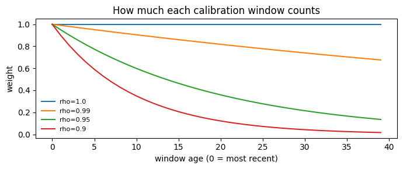
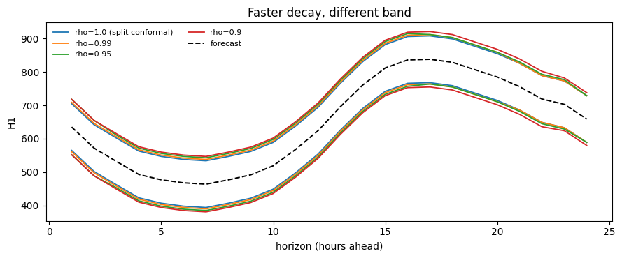

NexCP answers the same problem as [ACI](./aci.html) — the world moved
and the calibration set is stale — from the opposite direction. Rather
than moving the coverage target, it changes whose errors count.

## What it does

Split conformal treats all `n` calibration windows as equally
informative, which is precisely the exchangeability assumption. NexCP
drops it and weights each window by its age:

``` text
w_i = rho ** (age of window i)
```

The newest window has weight `1`, the one before it `rho`, and so on.
The threshold is then the exact **weighted** order statistic of the
scores under those weights, not the unweighted one.

`rho` controls the memory. At `rho = 1` every weight is `1` and NexCP is
exactly split conformal. At `rho = 0.9` a window 20 steps back carries
12% of the newest window’s vote, and one 50 steps back is essentially
ignored.

Barber et al. give the price explicitly: the coverage gap is bounded by
the total variation between the weighted calibration distribution and
the test point’s. Down-weighting stale data shrinks that gap when the
process drifts, and costs you effective sample size when it does not.

> **The window axis has to mean time**
>
> NexCP reads axis 1 of the calibration arrays as chronological, oldest
> first. That is what `calibrate_cv` produces. If you assemble
> calibration windows yourself, get the order right or the decay is
> applied to the wrong windows silently.

## Worked example

This page uses the eight-series M4 hourly panel rather than
AirPassengers, because weighting only matters when the series are long
enough for old windows to genuinely be stale.

```python
import matplotlib.pyplot as plt
import numpy as np
import pandas as pd
from statsforecast import StatsForecast
from statsforecast.models import SeasonalNaive

from conformalforecast import NonexchangeableConformalPrediction
from conformalforecast import panel as P
from conformalforecast.adapters import StatsForecastAdapter
from conformalforecast.diagnostics import evaluate, nexcp_state

HORIZON, SEASON, ALPHA = 24, 24, 0.1
N_HOLDOUT = 3

df = pd.read_csv("nbs/data/m4_hourly_panel.csv", parse_dates=["ds"])
matrix, index = P.long_to_panel(df["y"].to_numpy(), df["unique_id"].to_numpy(), df["ds"].to_numpy())
print("panel", matrix.shape, "series", index.series_ids)

# Hold the tail out before anything is fitted, so the coverage measured at the
# end of this page is measured on data no part of the pipeline has seen.
train_df = df[df["ds"] <= df["ds"].max() - pd.Timedelta(hours=N_HOLDOUT * HORIZON)].reset_index(
    drop=True
)
print("training through", train_df["ds"].max(), f"({N_HOLDOUT * HORIZON} hours held out)")

sf = StatsForecast(models=[SeasonalNaive(season_length=SEASON)], freq="h", n_jobs=1)
sf.fit(train_df)
forecaster = StatsForecastAdapter(
    sf=sf, train_df=train_df, horizon=HORIZON, freq="h", model_name="SeasonalNaive"
)
```

``` text
panel (8, 672) series ('H1', 'H10', 'H100', 'H150', 'H200', 'H300', 'H400', 'H50')
training through 2015-01-25 23:00:00 (72 hours held out)
```

> **`refit=True` for `SeasonalNaive`**
>
> `SeasonalNaive` has no `forward` method, so statsforecast cannot reuse
> fitted parameters across cutoffs and `calibrate_cv` must refit at each
> one. For this model that is free — there is nothing to fit.

```python
N_WINDOWS = 40
RHOS = [1.0, 0.99, 0.95, 0.9]

fits, states = {}, {}
for rho in RHOS:
    method = NonexchangeableConformalPrediction(alpha=ALPHA, rho=rho)
    fits[rho] = method.calibrate_cv(forecaster, n_windows=N_WINDOWS, refit=True)
    states[rho] = nexcp_state(fits[rho])

for rho, state in states.items():
    label = "rho=1.0 (= split conformal)" if rho == 1.0 else f"rho={rho}"
    print(
        f"{label:28s} effective sample size {state['effective_sample_size']:6.2f}"
        f"   of {N_WINDOWS} windows"
    )
```

``` text
rho=1.0 (= split conformal)  effective sample size  40.00   of 40 windows
rho=0.99                     effective sample size  39.47   of 40 windows
rho=0.95                     effective sample size  30.12   of 40 windows
rho=0.9                      effective sample size  18.45   of 40 windows
```

The effective sample size is what the decay costs. `rho = 0.99` is
almost free here — 39.5 of 40 windows — while `rho = 0.9` leaves the
equivalent of about 18. Fewer effective windows means a coarser quantile
grid and a noisier threshold. That is the trade: less stale information,
but also less information.

```python
ages = np.arange(N_WINDOWS)
fig, ax = plt.subplots(figsize=(7, 3))
for i, rho in enumerate(RHOS):
    ax.plot(ages, np.power(rho, ages), color=f"C{i}", lw=1.5, label=f"rho={rho}")
ax.set_xlabel("window age (0 = most recent)")
ax.set_ylabel("weight")
ax.set_title("How much each calibration window counts")
ax.legend(fontsize=8, frameon=False)
fig.tight_layout()
```



## What it does to the intervals

```python
predictions = {rho: fits[rho].predict(matrix) for rho in RHOS}

series = 0
steps = np.arange(1, HORIZON + 1)
fig, ax = plt.subplots(figsize=(9, 3.8))
for i, rho in enumerate(RHOS):
    interval = predictions[rho].interval[series, 0]
    label = "rho=1.0 (split conformal)" if rho == 1.0 else f"rho={rho}"
    ax.plot(steps, interval[:, 0], color=f"C{i}", lw=1.3, label=label)
    ax.plot(steps, interval[:, 1], color=f"C{i}", lw=1.3)
ax.plot(steps, predictions[1.0].point[series, 0], color="k", lw=1.4, ls="--", label="forecast")
ax.set_xlabel("horizon (hours ahead)")
ax.set_ylabel(f"{index.series_ids[series]}")
ax.set_title("Faster decay, different band")
ax.legend(fontsize=8, frameon=False, ncol=2)
fig.tight_layout()
```



```python
widths = {
    rho: (predictions[rho].interval[..., 1] - predictions[rho].interval[..., 0]).mean(axis=(1, 2))
    for rho in RHOS
}
header = "series   " + "".join(f"{('rho=' + str(r)):>12s}" for r in RHOS)
print(header)
for s, name in enumerate(index.series_ids):
    row = "".join(f"{widths[rho][s]:12.1f}" for rho in RHOS)
    print(f"{name:9s}{row}")
```

``` text
series        rho=1.0    rho=0.99    rho=0.95     rho=0.9
H1              140.0       146.7       155.0       165.3
H10              44.4        63.3       110.9       199.8
H100            539.5       610.9       666.8       811.3
H150            179.9       206.5       217.4       257.4
H200              0.4         0.4         0.4         0.4
H300              0.5         0.5         0.6         0.6
H400             89.3        93.8       133.2       205.0
H50            8804.0      8829.0      8829.8      9336.3
```

The widths move by series, not uniformly: `rho` reweights each series’
own residual history, so a series whose recent errors are unlike its old
ones changes a lot — `H10` more than quadruples between `rho = 1.0` and
`rho = 0.9` — while a stable one such as `H200` barely moves. A single
global multiplier could not do that.

## Measured coverage

```python
histories, truths = [], []
for k in range(N_HOLDOUT):
    end = matrix.shape[1] - (N_HOLDOUT - k) * HORIZON
    histories.append(matrix[:, :end])
    truths.append(matrix[:, end : end + HORIZON])
truths = np.stack(truths, axis=1)

for rho in RHOS:
    report = evaluate(fits[rho], histories, truths)
    label = "rho=1.0 (split)" if rho == 1.0 else f"rho={rho}"
    print(
        f"{label:18s} coverage {report.marginal_coverage:6.1%}   "
        f"width {report.mean_interval_width:9.1f}   "
        f"Winkler {report.mean_winkler_score:9.1f}"
    )
```

``` text
rho=1.0 (split)    coverage  85.9%   width    1227.7   Winkler    1369.0
rho=0.99           coverage  89.4%   width    1241.2   Winkler    1360.8
rho=0.95           coverage  92.5%   width    1263.8   Winkler    1338.8
rho=0.9            coverage  94.8%   width    1371.3   Winkler    1429.2
```

> **The decay pays for itself here, up to a point**
>
> Split conformal (`rho = 1.0`) under-covers on this holdout — 85.9%
> against a 90% target — because it weights a residual from 40 hours
> back exactly as heavily as the most recent one. Every decay setting
> closes that gap, `rho = 0.99` almost exactly (89.4%), and the Winkler
> score, which charges width and misses on one scale, improves with it,
> bottoming out at `rho = 0.95` (1338.8 against split’s 1369.0).
>
> Past that the trade turns over. `rho = 0.9` buys 94.8% coverage, well
> beyond what was asked for, and pays 12% more width than split
> conformal to get it; its Winkler score is the worst of the four. That
> is the shape to expect — forgetting stale residuals helps while they
> really are misleading, and costs you effective sample size once they
> are not. Measure before tuning `rho`, in both directions.

## When not to use it

-   **Your calibration set is small.** Decay throws away effective
    sample size you may not have. Check `effective_sample_size` against
    `ceil(1/alpha)` before trusting the result.
-   **Your drift is abrupt rather than gradual.** An exponential decay
    is a smooth forgetting curve. A step change is handled better by
    [ACI](./aci.html), whose controller reacts to misses directly.
-   **You do not know how fast to forget.** `rho` is as much a tuning
    parameter as ACI’s `gamma`, and NexCP has no aggregated variant. If
    that bothers you, use [AgACI](./agaci.html).

## References

R. F. Barber, E. J. Candes, A. Ramdas, and R. J. Tibshirani, “Conformal
prediction beyond exchangeability,” arXiv.org, 2022.
https://arxiv.org/abs/2202.13415.

## Next

-   [SPCI](./spci.html) — the last online method, and the only one that
    changes the shape of the band rather than its level.
-   [Ragged panels](../capabilities/ragged-panels.html) — what the
    window axis means when series have different lengths, which is
    exactly what NexCP reads.

