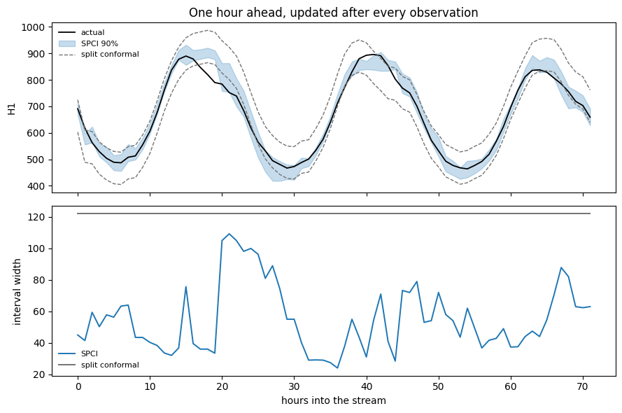

The residual-based methods take their width from a quantile of past
errors, so at a given horizon step it is a constant. SPCI fits a
quantile regressor on the recent residual history and predicts the next
residual’s spread instead, so the width moves with the state the series
is in.

## What it does

For each `(series, horizon)` cell, SPCI fits a quantile regressor that
predicts the *next* signed residual from the previous `window_size`
residuals — and from exogenous features, if you supply them. Call its
predicted quantile function `Q`. The interval is

``` text
[ŷ + Q(beta), ŷ + Q(1 - alpha + beta)]
```

for whichever `beta` in `[0, alpha]` makes it narrowest. That search is
the second idea: an interval of the right coverage need not be centred.
When the residual distribution is skewed, spending more of `alpha` on
one tail gives a tighter interval at the same nominal level, and SPCI
searches a grid of `beta_grid_size` candidates for the best split.

Because `Q` depends on the recent residual history, the width moves with
the data. A run of large errors widens the next interval directly,
without waiting for a controller to notice a miss.

> **Original method**
>
> The paper’s estimator is a quantile random forest, which is also this
> implementation’s default.

> **SPCI needs the `spci` extra and costs more than the others**
>
> The default `QRFQuantileRegressor` wraps `quantile-forest`:
> `pip install conformalforecast[spci]`. SPCI is also the one sanctioned
> exception to the package’s no-per-cell-loops rule — it fits one
> regressor per `(series, horizon)` cell, so an 8-series panel at
> horizon 24 means 192 forests. Keep the grid small, or raise
> `refit_every` so the regressors are refitted less often.

## Worked example

SPCI is formulated for sequential one-step-ahead prediction, so that is
what this page does: forecast one hour ahead on a single M4 hourly
series, and stream three days through the method an observation at a
time.

```python
import matplotlib.pyplot as plt
import numpy as np
import pandas as pd
from statsforecast import StatsForecast
from statsforecast.models import SeasonalNaive

from conformalforecast import SequentialPredictiveConformalInference, SplitConformal
from conformalforecast.adapters import StatsForecastAdapter
from conformalforecast.diagnostics import spci_state

SEASON, ALPHA, WINDOW = 24, 0.1, 48
N_STREAM = 72  # three days, one hour at a time

full = pd.read_csv("nbs/data/m4_hourly_panel.csv", parse_dates=["ds"])
df = full[full["unique_id"] == "H1"].reset_index(drop=True)
series = df["y"].to_numpy()[None, :]
train_end = series.shape[1] - N_STREAM
train_df = df.iloc[:train_end].reset_index(drop=True)

sf = StatsForecast(models=[SeasonalNaive(season_length=SEASON)], freq="h", n_jobs=1)
sf.fit(train_df)
forecaster = StatsForecastAdapter(
    sf=sf, train_df=train_df, horizon=1, freq="h", model_name="SeasonalNaive"
)

spci = SequentialPredictiveConformalInference(alpha=ALPHA, window_size=WINDOW, refit_every=4)
spci_fitted = spci.calibrate_cv(forecaster, n_windows=150, refit=True)

split_fitted = SplitConformal(alpha=ALPHA).calibrate_cv(forecaster, n_windows=150, refit=True)

state = spci_state(spci_fitted)
for key in ("window_size", "n_observations", "n_regressors", "regressor_class", "refit_every"):
    print(f"{key:18s} {state[key]}")
```

``` text
window_size        48
n_observations     150
n_regressors       1
regressor_class    QRFQuantileRegressor
refit_every        4
```

`n_regressors` is the `(series × horizon)` grid — one series, one
horizon step, so one forest. Each saw `n_observations` residuals and
keeps the last `window_size` of them as its feature vector.

> **SPCI needs a longer calibration set than the others**
>
> The minimum is `max(window_size + 1, ceil(1/alpha))` effective
> residuals per series, not just `ceil(1/alpha)` — the regressor needs a
> full window before it can predict anything. That is why this page asks
> for 150 cross-validation windows where the split conformal page needed
> 24.

```python
def stream(fitted, *, online=True):
    """Roll one hour at a time, recording the interval and whether it covered."""
    lower, upper, covered = [], [], []
    for t in range(train_end, series.shape[1]):
        prediction = fitted.predict(series[:, :t])
        lo, hi = prediction.interval[0, 0, 0]
        lower.append(lo)
        upper.append(hi)
        covered.append(lo <= series[0, t] <= hi)
        if online:
            fitted.update(prediction.point, series[:, t : t + 1][:, None, :])
    return {"lower": np.array(lower), "upper": np.array(upper), "covered": np.array(covered)}


runs = {"SPCI": stream(spci_fitted), "split conformal": stream(split_fitted, online=False)}

for name, run in runs.items():
    width = run["upper"] - run["lower"]
    print(
        f"{name:18s} coverage {run['covered'].mean():6.1%}   "
        f"mean width {width.mean():7.1f}   "
        f"width range {width.min():6.1f} - {width.max():6.1f}"
    )
```

``` text
SPCI               coverage  81.9%   mean width    55.1   width range   24.0 -  109.3
split conformal    coverage  79.2%   mean width   122.0   width range  122.0 -  122.0
```

## Width that moves

```python
hours = np.arange(N_STREAM)
truth = series[0, train_end:]

fig, (top, bottom) = plt.subplots(2, 1, figsize=(9, 6), sharex=True)

top.plot(hours, truth, color="k", lw=1.3, label="actual")
top.fill_between(
    hours,
    runs["SPCI"]["lower"],
    runs["SPCI"]["upper"],
    color="C0",
    alpha=0.25,
    label="SPCI 90%",
)
top.plot(
    hours, runs["split conformal"]["lower"], color="0.45", lw=1, ls="--", label="split conformal"
)
top.plot(hours, runs["split conformal"]["upper"], color="0.45", lw=1, ls="--")
top.set_ylabel("H1")
top.set_title("One hour ahead, updated after every observation")
top.legend(fontsize=8, frameon=False, loc="upper left")

for name, colour in [("SPCI", "C0"), ("split conformal", "0.45")]:
    bottom.plot(hours, runs[name]["upper"] - runs[name]["lower"], color=colour, lw=1.4, label=name)
bottom.set_ylabel("interval width")
bottom.set_xlabel("hours into the stream")
bottom.legend(fontsize=8, frameon=False)
fig.tight_layout()
```



The bottom panel is the whole argument. Split conformal draws a
horizontal line — its width is a constant of the fitted state, identical
at 3 a.m. and at the evening peak. SPCI’s width rises and falls, because
the residuals it regresses on do.

Both are valid intervals. Only one of them is *informative*: a width
that carries a signal tells you something the point forecast does not.

Here that pays on both axes at once. SPCI covered 82% of the stream at a
mean width of 55, while split conformal covered 79% at a constant width
of 122 — less than half the width for slightly better coverage. Note
that neither reached the 90% target over these particular 72 hours;
three days is a short measurement, and the widest SPCI intervals cluster
exactly where the series ramps.

> **Measure SPCI’s coverage before you trust it**
>
> SPCI’s validity is asymptotic and conditional on the residual model
> being reasonable, which is a much weaker footing than split
> conformal’s finite-sample guarantee. Two consequences show up in
> practice:
>
> -   Even on well-behaved data it tends to land a few points **below**
>     nominal. The package’s own coverage test
>     (`tests/unit/methods/test_spci.py`) allows a tolerance of 0.08
>     around the target for exactly this reason.
> -   At **multi-step horizons on real series** the gap can be much
>     larger. On this same panel at horizon 6, SPCI covers around 65%
>     against a 90% target while split conformal holds 90% — the
>     quantile forest is asked to extrapolate to residual magnitudes it
>     never saw in training, and tree models cannot extrapolate.
>
> Neither is a reason to avoid SPCI; both are reasons to run
> [`evaluate`](../capabilities/diagnostics) on your own data and horizon
> before shipping it, rather than assuming the guarantee carries over.

## When not to use it

-   **You cannot install the extra.** SPCI is the only method with a
    third-party dependency.
-   **Your grid is large.** `n_series × horizon` regressors, refitted as
    you go. A 100-series panel at horizon 48 is 4 800 forests — consider
    [CQR](cqr), which gets varying width from a model you already fit.
-   **Your calibration set is short.** `window_size + 1` residuals per
    series is a real constraint, and the default `window_size` is 100.
-   **You need the classical guarantee, or a long horizon.** [Split
    conformal](split) is finite-sample and assumption-light; on this
    data it is also the one that holds its coverage at horizon 6.

## References

X. Chen and X. Yao, “Sequential Predictive Conformal Inference for Time
Series,” arXiv.org, 2022. https://arxiv.org/abs/2212.03463.

## Next

-   [Methods overview](index) — the decision guide, now that you have
    seen all six.
-   [Exogenous features](../capabilities/exogenous) — SPCI is the method
    that can actually use them.
-   [Diagnostics](../capabilities/diagnostics) — how to run the
    measurement the callout above asks for.

