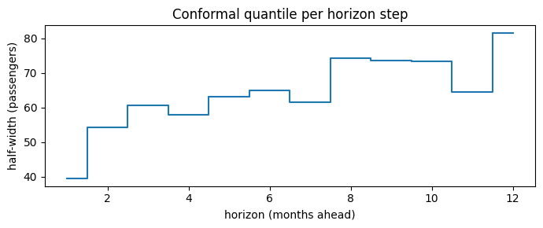
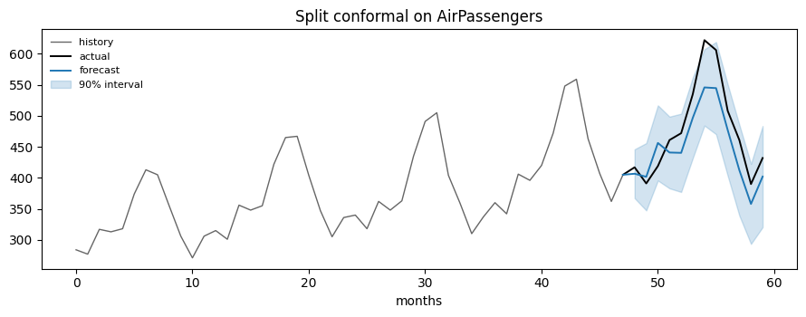
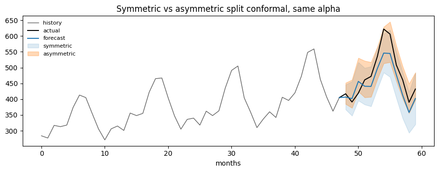

Split conformal prediction is the baseline every other method sits on.
Calibrate on a block of past errors, take a quantile of them, and add it
to the point forecast.

## What it does

Given calibration forecasts and truths, it scores each one — by default
with the absolute residual `s = |y - ŷ|` — and takes the **exact
conformal quantile** of those scores:

``` text
k = ceil((1 - alpha) * (n + 1))
q = the k-th smallest of s_1 ... s_n
```

The interval is `[ŷ - q, ŷ + q]`. The `n + 1` is not a rounding detail:
it is what makes the coverage guarantee finite-sample rather than
asymptotic. With `n = 24` windows and `alpha = 0.1`, `k = 23`, so `q` is
the 23rd smallest of the 24 calibration scores.

One `q` is stored per `(series, horizon)` cell, so the band can widen
with the horizon and differ across a panel even though the score
function is shared.

## Worked example

```python
import matplotlib.pyplot as plt
import numpy as np
import pandas as pd
from statsforecast import StatsForecast
from statsforecast.models import AutoETS

from conformalforecast import SplitConformal
from conformalforecast.adapters import StatsForecastAdapter
from conformalforecast.diagnostics import evaluate

HORIZON, SEASON, ALPHA = 12, 12, 0.1

df = pd.read_csv("nbs/data/air_passengers.csv", parse_dates=["ds"])
panel = df["y"].to_numpy()[None, :]
cutoff = panel.shape[1] - HORIZON
train_df = df.iloc[:cutoff].reset_index(drop=True)

sf = StatsForecast(models=[AutoETS(season_length=SEASON)], freq="MS", n_jobs=1)
sf.fit(train_df)
forecaster = StatsForecastAdapter(
    sf=sf, train_df=train_df, horizon=HORIZON, freq="MS", model_name="AutoETS"
)

method = SplitConformal(alpha=ALPHA)
fitted = method.calibrate_cv(forecaster, n_windows=24)

n = int(fitted.n_calibration_samples_[0])
print(f"n = {n} calibration windows, k = {int(np.ceil((1 - ALPHA) * (n + 1)))}")
```

``` text
n = 24 calibration windows, k = 23
```

`calibrate_cv` returned a new fitted object and left `method` untouched;
its `score_quantile_` is that `q`, one per `(series, horizon)` cell.
Plotting it against the horizon shows the band widening as the ETS
forecast has more room to drift.

```python
q = fitted.score_quantile_[0]

fig, ax = plt.subplots(figsize=(7, 3))
ax.step(np.arange(1, HORIZON + 1), q, where="mid", color="C0")
ax.set_xlabel("horizon (months ahead)")
ax.set_ylabel("half-width (passengers)")
ax.set_title("Conformal quantile per horizon step")
fig.tight_layout()
```



```python
prediction = fitted.predict(panel[:, :cutoff])

tail = panel[0, cutoff - 48 : cutoff]
past = np.arange(len(tail))
future = np.arange(len(tail), len(tail) + HORIZON)
join = np.r_[past[-1], future]

fig, ax = plt.subplots(figsize=(9, 3.6))
ax.plot(past, tail, color="0.4", lw=1, label="history")
ax.plot(join, np.r_[tail[-1], panel[0, cutoff:]], color="k", lw=1.4, label="actual")
ax.plot(join, np.r_[tail[-1], prediction.point[0, 0]], color="C0", lw=1.4, label="forecast")
ax.fill_between(
    future,
    prediction.interval[0, 0, :, 0],
    prediction.interval[0, 0, :, 1],
    color="C0",
    alpha=0.2,
    label="90% interval",
)
ax.set_title("Split conformal on AirPassengers")
ax.set_xlabel("months")
ax.legend(loc="upper left", fontsize=8, frameon=False)
fig.tight_layout()
```



## Measured coverage

```python
N_HOLDOUT = 4
histories, truths = [], []
for k in range(N_HOLDOUT):
    end = panel.shape[1] - (N_HOLDOUT - k) * HORIZON
    histories.append(panel[:, :end])
    truths.append(panel[:, end : end + HORIZON])

report = evaluate(fitted, histories, np.stack(truths, axis=1))
print(report.summary())
```

``` text
Report — SplitConformal
  target coverage: 0.900
  marginal coverage: 0.938
  coverage by horizon: [1.000, 1.000, 1.000, 1.000, 1.000, 1.000, 0.500, 0.750, 1.000, 1.000, 1.000, 1.000]
  mean width: 128.190
  mean Winkler score: 149.198
  n_holdout_samples: 4
```

## Asymmetric intervals

Everything above builds an equal-width band centred on the forecast,
because the absolute residual `|y - ŷ|` throws away the sign of the
error. It targets total coverage `1 - alpha` and says nothing about how
the misses split between the tails: with skewed residuals one tail can
take nearly all of them. And the symmetric band has a cost: a forecaster
that is *biased* — consistently high or consistently low — can only be
covered by widening the band on both sides, including the side the
errors never fall on.

`symmetric=False` scores the **signed** residual `r = y - ŷ` instead and
takes one one-sided conformal quantile per tail:

``` text
lower_offset = the alpha_lo quantile of r_1 ... r_n
upper_offset = the alpha_hi quantile of the same r
```

with the same `n + 1` correction as before, and the interval becomes
`[ŷ + lower_offset, ŷ + upper_offset]`. Both offsets are stored per
`(series, horizon)` cell, so `score_quantile_` gains a trailing axis of
size 2. Nothing constrains them to be mirror images, so the band can
**shift** as well as widen.

The two levels are bound by `alpha_lo + (1 - alpha_hi) == alpha`: the
tails move against each other on a fixed budget, and both are mandatory
once `symmetric=False`. Setting them to `alpha/2` each — `0.05` and
`0.95` here — gives the equal-tailed interval: the same total `alpha` as
the symmetric fit, but now `alpha/2` per tail, and the band is no longer
forced to be centred. The price is calibration data — each tail needs at
least `ceil(2 / alpha)` windows per series instead of `ceil(1 / alpha)`.

```python
asym = SplitConformal(alpha=ALPHA, symmetric=False, alpha_lo=0.05, alpha_hi=0.95)
asym_fitted = asym.calibrate_cv(forecaster, n_windows=24)

q_asym = asym_fitted.score_quantile_[0]
print("score_quantile_ shape:", q_asym.shape, "-> (horizon, [lower, upper])\n")

signed = fitted.truths_calibration_ - fitted.predictions_calibration_
print(f"share of calibration residuals above the forecast: {np.mean(signed > 0):.1%}")
print(f"mean signed residual: {np.mean(signed):+.1f} passengers\n")

print(f"{'h':>3}  {'lower':>8} {'upper':>8}  {'width':>7}  {'symmetric':>9}")
for h in (0, 5, 11):
    lo, hi = q_asym[h]
    print(f"{h + 1:>3}  {lo:>8.1f} {hi:>8.1f}  {hi - lo:>7.1f}  {2 * q[h]:>9.1f}")
width_asym, width_sym = q_asym[:, 1] - q_asym[:, 0], 2 * q
print(f"\nmean width  asymmetric {width_asym.mean():.1f}  vs symmetric {width_sym.mean():.1f}")
print(f"narrower at {(width_asym < width_sym).sum()} of {HORIZON} steps")
print(f"highest lower offset: {q_asym[:, 0].max():+.1f} at step {q_asym[:, 0].argmax() + 1}")
```

``` text
score_quantile_ shape: (12, 2) -> (horizon, [lower, upper])

share of calibration residuals above the forecast: 74.3%
mean signed residual: +19.5 passengers

  h     lower    upper    width  symmetric
  1     -22.1     45.1     67.2       78.8
  6     -33.4     68.2    101.6      130.0
 12      -4.4     82.2     86.6      163.2

mean width  asymmetric 102.2  vs symmetric 128.2
narrower at 11 of 12 steps
highest lower offset: -2.5 at step 11
```

AutoETS under-forecasts AirPassengers, so most calibration residuals
land *above* the forecast. The symmetric band has to reach that far
above **and** the same distance below, where almost nothing falls. The
asymmetric band puts its mass where the errors are, and is narrower at
eleven of the twelve steps at the same total `alpha` — the fourth step
is a dead heat, and none of them is meaningfully wider.

The gap is widest at the long end, where the bias has had the most room
to accumulate: at the twelfth step the asymmetric band is barely half
the width.

```python
pred_asym = asym_fitted.predict(panel[:, :cutoff])

fig, ax = plt.subplots(figsize=(9, 3.6))
ax.plot(past, tail, color="0.4", lw=1, label="history")
ax.plot(join, np.r_[tail[-1], panel[0, cutoff:]], color="k", lw=1.4, label="actual")
ax.plot(join, np.r_[tail[-1], prediction.point[0, 0]], color="C0", lw=1.4, label="forecast")
ax.fill_between(
    future,
    prediction.interval[0, 0, :, 0],
    prediction.interval[0, 0, :, 1],
    color="C0",
    alpha=0.15,
    label="symmetric",
)
ax.fill_between(
    future,
    pred_asym.interval[0, 0, :, 0],
    pred_asym.interval[0, 0, :, 1],
    color="C1",
    alpha=0.30,
    label="asymmetric",
)
ax.set_title("Symmetric vs asymmetric split conformal, same alpha")
ax.set_xlabel("months")
ax.legend(loc="upper left", fontsize=8, frameon=False)
fig.tight_layout()
```



On the same holdout measured earlier:

```python
asym_report = evaluate(asym_fitted, histories, np.stack(truths, axis=1))
print(asym_report.summary())
```

``` text
Report — SplitConformal
  target coverage: 0.900
  marginal coverage: 0.979
  coverage by horizon: [1.000, 1.000, 0.750, 1.000, 1.000, 1.000, 1.000, 1.000, 1.000, 1.000, 1.000, 1.000]
  mean width: 102.243
  mean Winkler score: 104.610
  n_holdout_samples: 4
```

Narrower on average and better covered, with a lower Winkler score —
which is the combination that says the symmetric band was paying for
width it did not need. Do not read too much into four holdout windows;
the point is the direction, and the mechanism behind it is visible in
the offsets above.

### The calibration data has to stretch further

Each tail is now its own one-sided quantile, so each enforces its own
`ceil(1 / level)` floor. The binding requirement is the stricter of the
two:

``` text
max(ceil(1 / alpha_lo), ceil(1 / (1 - alpha_hi)))
```

For the even split that is `ceil(1 / 0.05) = 20`, comfortably under the
24 windows this page calibrates on. Tilt the budget toward the lower
tail and the floor moves fast:

```python
from conformalforecast.base import InsufficientCalibrationSamples

try:
    tilted = SplitConformal(alpha=ALPHA, symmetric=False, alpha_lo=0.02, alpha_hi=0.92)
    tilted.calibrate_cv(forecaster, n_windows=24)
except InsufficientCalibrationSamples as err:
    print(f"{type(err).__name__}: {err}")
    print("series:", err.series_indices)
```

``` text
InsufficientCalibrationSamples: Series [0] have fewer than ceil(1/alpha) = 50 effective calibration samples for alpha=0.02 (from alpha_lo=0.02).
series: [0]
```

`alpha_lo=0.02` needs 50 calibration windows on its own, and the message
names `alpha_lo` rather than quoting the `alpha` you passed — the
failing knob is the one you want to see. Budget for it: an asymmetric
interval with a narrow tail needs several times the calibration data a
symmetric one at the same `alpha` would.

> **A one-sided interval means the forecaster is biased**
>
> If both offsets come out with the same sign, the interval lies
> entirely above or entirely below the point forecast, and `fit` warns:
>
> ``` text
> Asymmetric split conformal produced an interval lying entirely on one side of
> the point forecast. The forecaster is biased on this calibration data; the
> interval is shifting rather than widening to compensate.
> ```
>
> That is not a defect in the method — it is the method reporting one in
> the forecaster, and the offsets it produces are still valid. The fit
> above does not trip it, but not by much: its highest lower offset is
> `-2.5`, at the eleventh step, so a little more drift would put the
> whole band above the forecast. Fix the bias in the model if you can;
> conformalizing around it works, but it spends interval width on a
> problem a better point forecast would not have.

Use `symmetric=False` when one tail carries the real cost — inventory,
staffing, capacity — or when the forecaster is biased and you would
rather shift than widen. Stay symmetric otherwise: it needs less
calibration data, and an uninformative tilt just moves coverage around.
When the asymmetry depends on the *features* of each step rather than
being a constant offset, that is [CQR](cqr.html)’s job, not this one.

## Using the array surface

The forecaster surface did three things above: ran the cross-validation,
converted Nixtla frames to arrays, and called the calibration math. If
your library already owns the first two — which is the case inside
statsforecast, mlforecast and neuralforecast — you want the **array
surface**: `fit(predictions, truths)` on the method returns the same
kind of fitted object, and `interval(predictions)` on that object
applies it — no forecaster and no adapter anywhere in the signature.

```python
# Reuse the calibration arrays the forecaster surface already assembled.
predictions = fitted.predictions_calibration_
observed = fitted.truths_calibration_
print("calibration arrays:", predictions.shape, "(n_series, n_windows, horizon)")

array_fitted = SplitConformal(alpha=ALPHA).fit(predictions, observed)
interval = array_fitted.interval(prediction.point)

print("interval", interval.shape)
np.testing.assert_allclose(interval, prediction.interval)
print("identical to the forecaster-surface result")
```

``` text
calibration arrays: (1, 24, 12) (n_series, n_windows, horizon)
interval (1, 1, 12, 2)
identical to the forecaster-surface result
```

## When not to use it

-   **Your coverage drifts over time.** Split conformal calibrates once
    and never looks again, so a regime change leaves it silently
    mis-calibrated. Use [ACI](aci.html), [AgACI](agaci.html) or
    [NexCP](nexcp.html).
-   **Your errors are strongly heteroscedastic.** The absolute-residual
    score makes one constant-width band per cell. If the noise scales
    with the level, that band is wrong nearly everywhere. Use
    [CQR](cqr.html).
-   **You need the width itself to be informative.** A constant band
    cannot say “this particular step is unusually uncertain”. Use
    [SPCI](spci.html).

None of these are reasons to skip split conformal first — it is the
measurement that tells you which of the three problems you actually
have.

## References

-   H. Papadopoulos, Kostas Proedrou, V. Vovk, and A. Gammerman,
    “Inductive Confidence Machines for Regression,” pp. 345–356,
    Jan. 2002, doi: 10.1007/3-540-36755-1_29.
-   V. Vovk, A. Gammerman, and G. Shafer, Algorithmic Learning in a
    Random World. Springer Nature, 2005. doi: 10.1007/b106715.
-   J. Lei, M. G’Sell, A. Rinaldo, R. J. Tibshirani, and L. Wasserman,
    “Distribution-Free Predictive Inference For Regression,” 2016.
    https://arxiv.org/abs/1604.04173

## Next

-   [CQR](cqr.html) — the other offline method, for heteroscedastic
    errors.
-   [Methods overview](index.html) — the decision guide.
-   [Diagnostics](../capabilities/diagnostics.html) — measuring an
    interval properly.

