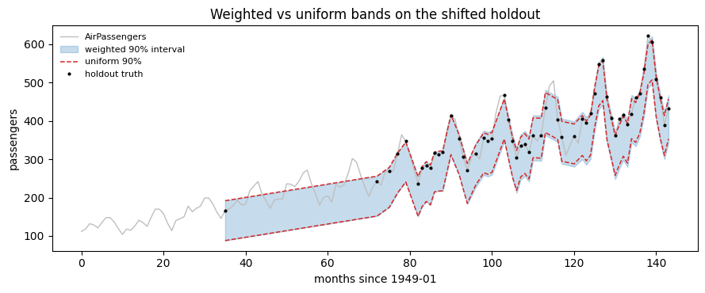

[Split conformal](./split.html) treats every calibration residual as
equally informative about the next one. That is exactly what
exchangeability buys, and **covariate shift** is the assumption failing
in the most common way: the steps you are about to predict do not look
like the steps you calibrated on. A model calibrated on a quiet,
low-volume stretch of a series is asked about a high-volume one; a panel
calibrated on one set of stores is asked about another.

`WeightedSplit` keeps the whole split-conformal construction and changes
exactly one thing: each calibration score gets a **weight** saying how
likely its features are under the target distribution rather than the
source one. Nothing about the forecaster changes, and no target labels
are needed.

## What it does

Write `x` for the features of a predicted step. The importance weight is
the density ratio

``` text
w(x) = d_target(x) / d_source(x)
```

Calibration scores `s_1 ... s_n` are then normalized *including the test
point’s own weight*, and the interval takes the smallest score whose
cumulative normalized weight reaches `1 - alpha`:

``` text
p_i = w(x_i) / (sum_j w(x_j) + w(x_test))
q   = min { s_i : sum_{s_k <= s_i} p_k >= 1 - alpha }
```

The interval is `[y_hat - q, y_hat + q]`, one `q` per
`(series, sample, horizon)` cell — the quantile now moves with the test
point, which the unweighted method’s does not. Set every `w` to 1 and
the `w(x_test)` term becomes the familiar `+1` of
`k = ceil((1 - alpha)(n + 1))`, recovering split conformal exactly. That
is not a metaphor: before `adapt()` binds a weight function,
`WeightedSplit` is bit-identical to `SplitConformal`, and a test asserts
it.

The ratio itself is estimated, not known. `DensityRatio` labels source
rows `0` and target rows `1`, fits any binary classifier you hand it,
and reads the ratio off the odds `p / (1 - p)`. Calibration weights are
computed **out of fold**, so a calibration point’s weight never comes
from a model that trained on it.

## Worked example

AirPassengers has one property that makes it a clean covariate-shift
test: its error scale grows with its level. So `log` of the last twelve
months’ mean is a real driver of how large the next residual will be — a
genuine covariate, not a label in disguise.

The shift is built by splitting one-step-ahead windows on that feature:
each window goes to calibration or holdout with a probability that rises
with its level. Both halves keep full support — high-level windows
appear in calibration too, just rarely — which is the regime weighted
conformal is built for, and the regime it needs. A source that never saw
the target’s features cannot be reweighted into it.

```python
import matplotlib.pyplot as plt
import numpy as np
import pandas as pd
from sklearn.linear_model import LogisticRegression

from conformalforecast import WeightedSplit
from conformalforecast.adapters import CallableAdapter
from conformalforecast.weighting import DensityRatio

HORIZON, SEASON, ALPHA = 1, 12, 0.1

df = pd.read_csv("nbs/data/air_passengers.csv", parse_dates=["ds"])
series = df["y"].to_numpy()
T = series.size


def seasonal_naive(history):
    """Repeat the value from one season ago. Instant, and good enough here."""
    return history[:, -SEASON : -SEASON + HORIZON]


forecaster = CallableAdapter(predict_fn=seasonal_naive, horizon=HORIZON, n_series=1)

# One window per forecastable timestamp; its feature is known before the truth is.
starts = np.arange(2 * SEASON, T - HORIZON + 1)
levels = np.array([np.log(series[t - SEASON : t].mean()) for t in starts])

rng = np.random.default_rng(0)
z = (levels - np.median(levels)) / levels.std()
is_target = rng.random(starts.size) < 1 / (1 + np.exp(-3 * z))

print(f"{(~is_target).sum()} calibration windows, {is_target.sum()} holdout windows")
print(
    f"mean log-level: source {levels[~is_target].mean():.2f}, target {levels[is_target].mean():.2f}"
)
```

``` text
65 calibration windows, 55 holdout windows
mean log-level: source 5.40, target 5.88
```

The two halves are the same series, the same forecaster and the same
horizon. Only the feature distribution differs — which is the definition
of covariate shift, and the only thing weighting can repair.

```python
def build(mask):
    """Histories, truths and the 4-D feature block for a set of windows."""
    idx = np.flatnonzero(mask)
    histories = [series[None, :t] for t in starts[idx]]
    truths = np.stack([series[None, t : t + HORIZON] for t in starts[idx]], axis=1)
    X = np.stack([np.full((1, HORIZON, 1), levels[i]) for i in idx], axis=1)
    return histories, truths, X


src_histories, src_truths, src_X = build(~is_target)
tgt_histories, tgt_truths, tgt_X = build(is_target)

print("truths    ", src_truths.shape, "(n_series, n_windows, horizon)")
print("X         ", src_X.shape, "(n_series, n_windows, horizon, n_features)")
```

``` text
truths     (1, 65, 1) (n_series, n_windows, horizon)
X          (1, 65, 1, 1) (n_series, n_windows, horizon, n_features)
```

## Calibrate, then adapt

`calibrate(forecaster, histories, truths)` is the ordinary source-domain
verb: it fits the conformal quantile on source forecasts and source
truths. `adapt(weighting=..., target_X=...)` is the transfer verb,
called on the fitted object `calibrate` returned: it hands a weight
function the **features** of the target domain — no target truths — and
returns a new fitted object with the quantile rebuilt, leaving the
source fit untouched. See [Transfer and
adaptation](../capabilities/transfer.html) for the full set of verbs.

```python
def holdout_intervals(fitted, X=None):
    """Predict every holdout window, returning (n_windows, horizon) bounds."""
    lower, upper = [], []
    for k, history in enumerate(tgt_histories):
        step_X = None if X is None else X[:, k : k + 1]
        prediction = fitted.predict(history, X=step_X)
        lower.append(prediction.interval[0, 0, :, 0])
        upper.append(prediction.interval[0, 0, :, 1])
    return np.array(lower), np.array(upper)


def report(name, lower, upper):
    truth = tgt_truths[0]
    covered = ((truth >= lower) & (truth <= upper)).mean()
    print(f"{name:22s} coverage {covered:6.1%}   mean width {(upper - lower).mean():6.1f}")
    return covered


uniform = WeightedSplit(alpha=ALPHA).calibrate(forecaster, src_histories, src_truths, X=src_X)
uniform_bounds = holdout_intervals(uniform)

source = WeightedSplit(alpha=ALPHA).calibrate(forecaster, src_histories, src_truths, X=src_X)
weighted = source.adapt(
    weighting=DensityRatio(estimator=LogisticRegression(max_iter=1000), cv=5),
    target_X=tgt_X,
)
weighted_bounds = holdout_intervals(weighted, tgt_X)

report("uniform weights", *uniform_bounds)
report("density-ratio weights", *weighted_bounds)
summary = weighted.calibration_.diagnostics["weight_summary"]
print("weight summary        ", {k: round(v, 3) for k, v in summary.items()})
```

``` text
uniform weights        coverage  78.2%   mean width  104.0
density-ratio weights  coverage  89.1%   mean width  116.3
weight summary         {'min': 0.012, 'median': 0.181, 'max': 5.129}
```

Uniform weights under-cover: 78.2% against a 90% target, at a mean width
of 104.0. The calibration set is dominated by low-level windows whose
residuals are small, so the band is too narrow for the high-level
windows it is asked about. Density-ratio weights push mass onto the
calibration windows that resemble the target, and coverage climbs to
89.1% — a shade under nominal, well within what 65 calibration windows
can resolve — at a mean width of 116.3. That trade is the whole method:
the extra width is not waste, it is the width the target regime always
needed.

```python
order = np.argsort(starts[is_target])
t_axis = starts[is_target][order]
truth = tgt_truths[0, order, 0]

fig, ax = plt.subplots(figsize=(9, 3.8))
ax.plot(np.arange(T), series, color="0.75", lw=1, label="AirPassengers")
ax.fill_between(
    t_axis,
    weighted_bounds[0][order, 0],
    weighted_bounds[1][order, 0],
    color="C0",
    alpha=0.25,
    label="weighted 90% interval",
)
ax.plot(t_axis, uniform_bounds[0][order, 0], color="C3", lw=1.1, ls="--", label="uniform 90%")
ax.plot(t_axis, uniform_bounds[1][order, 0], color="C3", lw=1.1, ls="--")
ax.plot(t_axis, truth, "k.", ms=4, label="holdout truth")
ax.set_xlabel("months since 1949-01")
ax.set_ylabel("passengers")
ax.set_title("Weighted vs uniform bands on the shifted holdout")
ax.legend(loc="upper left", fontsize=8, frameon=False)
fig.tight_layout()
```



## Clipping, and how it can cost you coverage

An estimated density ratio is unbounded. One calibration point whose
classifier odds come out at 300 can carry more weight than the rest of
the panel put together, and the weighted quantile then rests on a single
residual. `DensityRatio` guards against that by clipping weights at
their `clip_quantile`, default `0.99`.

The guard is not free. Under a strong shift the *typical* target weight
is already large, so a clip calibrated on the source weights binds on
most of the test points — and every clipped point is one whose weighting
signal was thrown away. The sweep below is the synthetic covariate-shift
benchmark this package tests against: feature-dependent noise,
calibration drawn at `loc=0` and test at `loc=2.5`, 90% target.

```python
def shifted(n, seed, loc):
    """Zero forecasts with noise whose scale grows with a single feature."""
    gen = np.random.default_rng(seed)
    x = gen.normal(loc=loc, scale=1.0, size=(1, n, 1))
    noise = gen.normal(scale=1.0 + np.abs(x), size=(1, n, 1))
    return np.zeros((1, n, 1)), noise, x[..., np.newaxis]


cal_p, cal_t, cal_X = shifted(2000, 0, loc=0.0)
test_p, test_t, test_X = shifted(4000, 1, loc=2.5)


def sweep_coverage(fitted):
    iv = fitted.interval(test_p, X=test_X)
    return float(((test_t >= iv[..., 0]) & (test_t <= iv[..., 1])).mean())


plain = WeightedSplit(alpha=ALPHA).fit(cal_p, cal_t, X=cal_X)
print(f"uniform weights          coverage {sweep_coverage(plain):.4f}")

for clip in (None, 0.99, 0.999):
    adapted = plain.adapt(
        weighting=DensityRatio(
            estimator=LogisticRegression(max_iter=1000), cv=3, clip_quantile=clip
        ),
        target_X=test_X,
    )
    label = "off" if clip is None else str(clip)
    print(f"density ratio, clip {label:5s} coverage {sweep_coverage(adapted):.4f}")
```

``` text
uniform weights          coverage 0.6520
density ratio, clip off   coverage 0.9167
density ratio, clip 0.99  coverage 0.8213
density ratio, clip 0.999 coverage 0.8692
```

Read that table before accepting the default. Weighting is doing its job
— with clipping off, coverage goes from 0.6520 to 0.9167 against a 0.90
target. But at the default `clip_quantile=0.99` the same weights deliver
only 0.8213, because under this much shift the *median* test weight
saturates at the clip value: the guard binds on 59% of the points and
discards most of the signal it was meant to protect. Loosening it to
`0.999` recovers part of the gap, at 0.8692.

> **Tune `clip_quantile` against measured coverage**
>
> `clip_quantile=0.99` is a safe default for a mild shift and a poor one
> for a strong shift. If your weights are large across the board, the
> clip is not trimming outliers — it is flattening the whole weighting.
> Check the adapted object’s
> `calibration_.diagnostics["weight_summary"]`: when the median sits at
> the maximum, the clip is binding everywhere.

## When not to use it

-   **The shift is in `P(y|x)`, not `P(x)`.** Weighting reweights
    calibration points by how *likely their features* are in the target
    domain. It assumes the conditional error distribution given those
    features is unchanged. If the relationship itself moved — a new
    pricing rule, a changed measurement process, a forecaster that has
    gone stale — no reweighting of the old residuals describes the new
    ones. That is a job for [recalibration on target
    labels](../capabilities/transfer.html) if you have them, or an
    [online method](./aci.html) if you do not.
-   **The density ratio is badly estimated.** The weights are the output
    of a classifier, and a bad classifier gives confidently wrong
    weights. Too flexible and it memorises which rows are source and
    which are target, sending the ratio to zero and infinity; too rigid
    and it returns a constant, which is uniform weighting under another
    name. Clipping bounds the damage without removing it — and as the
    sweep above shows, the clip has its own failure mode.
-   **The supports do not overlap.** If no calibration window looks
    anything like the target, `d_source(x)` is near zero where the
    target lives, and the ratio is an extrapolation dressed up as a
    weight. Weighting redistributes evidence; it cannot manufacture it.
-   **You have target labels.** If you can observe target
    `(prediction, truth)` pairs, calibrating on them directly is
    strictly better than reweighting a proxy. Use
    [`recalibrate()`](../capabilities/transfer.html).
-   **You have no features at all.** With `X=None` the weight function
    cannot fit and `WeightedSplit` is plain split conformal. Reach for
    [NexCP](./nexcp.html) instead, which down-weights by *recency*
    rather than by features and needs no covariates.

## References

-   R. J. Tibshirani, R. F. Barber, E. J. Candes, and A. Ramdas,
    “Conformal prediction under covariate shift,” *Advances in Neural
    Information Processing Systems 32*, 2019.
    https://arxiv.org/abs/1904.06019

## Next

-   [Transfer and adaptation](../capabilities/transfer.html) —
    `calibrate`, `recalibrate` and `adapt`, and which one your target
    data allows.
-   [Split conformal](./split.html) — the unweighted method this reduces
    to.
-   [Diagnostics](../capabilities/diagnostics.html) — measuring coverage
    and width together.

